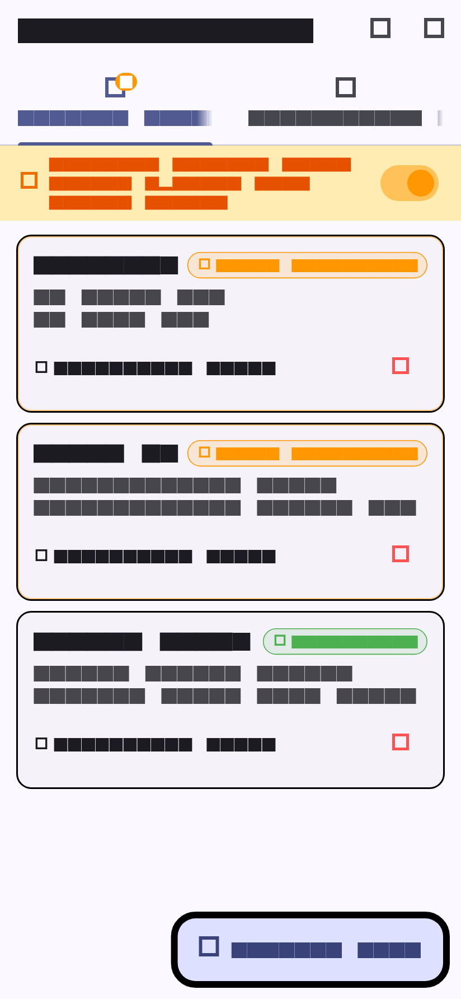
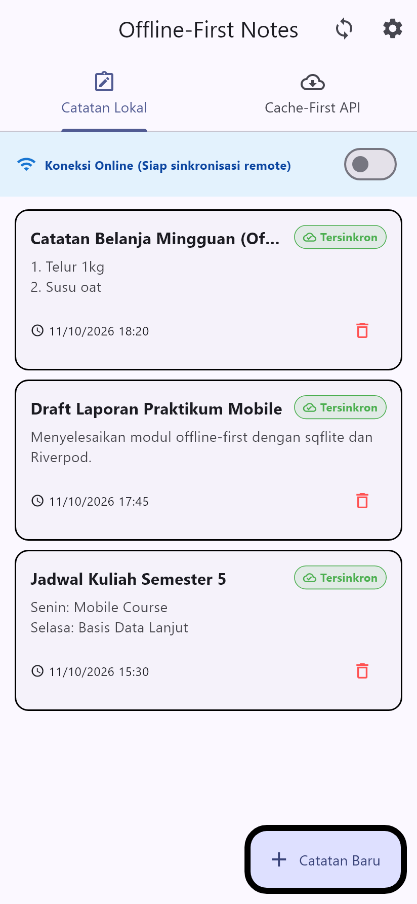
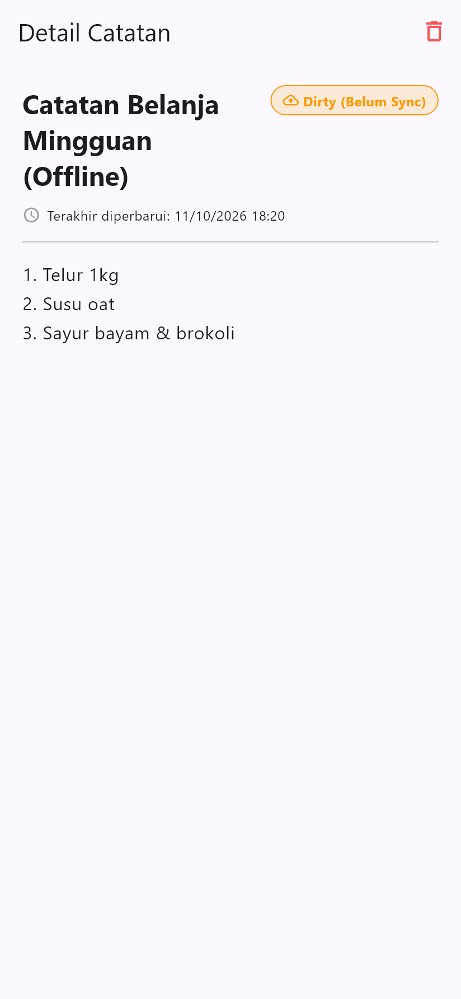
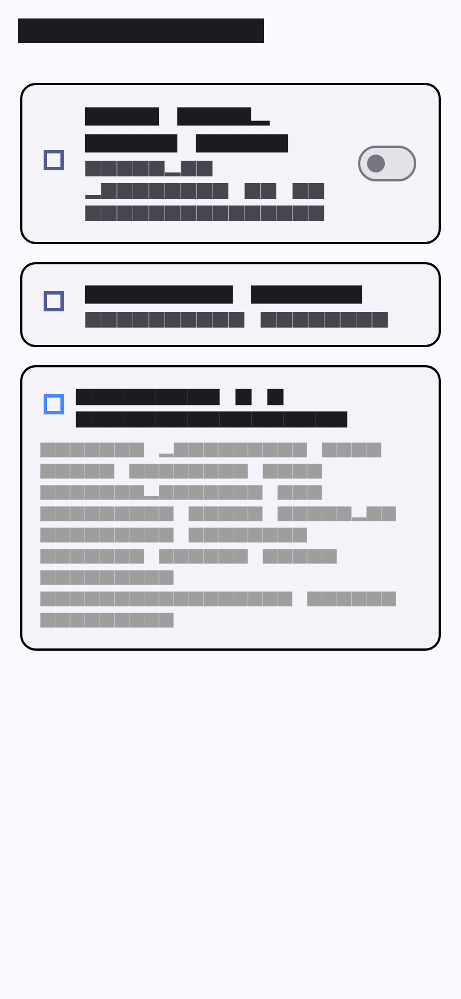
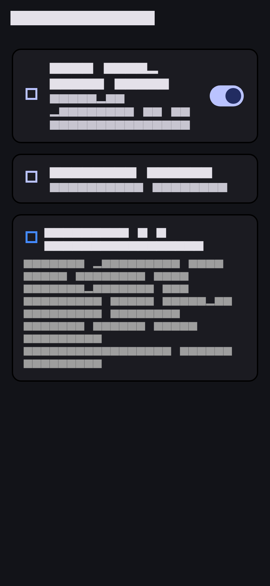
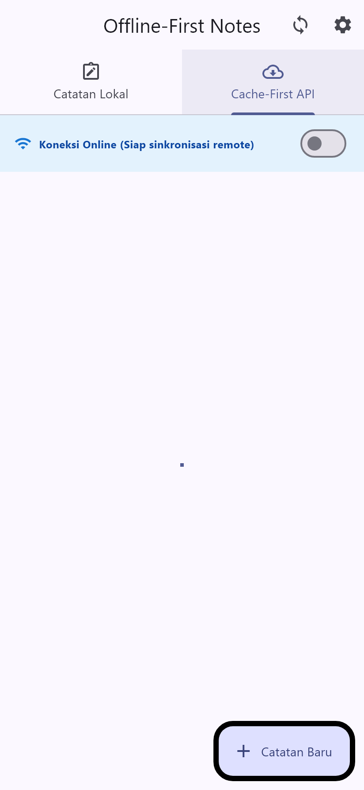

# Laporan Praktikum Pemrograman Mobile — Minggu 5
# Local Storage & Offline-First Notes

- **Mata Kuliah:** Pemrograman Mobile
- **Topik:** Local Storage (SharedPreferences & SQLite), Repository Pattern, Offline-First Architecture, Riverpod State Management, dan Testing.
- **Nama Mahasiswa:** Louis Judia B Sinaga
- **NIM:** 244107020071
- **Kelas:** TI-3H / Semester 5

---


## 1. Tujuan Pembelajaran
Setelah menyelesaikan praktikum Minggu 5 ini:
1. Mampu membedakan karakteristik dan use-case antara *key-value storage* (`SharedPreferences`), *relational storage* (`SQLite`), dan *NoSQL/reactive storage* (`Hive`, `Drift`).
2. Mampu menyimpan dan memuat preferensi pengguna secara persisten (tema gelap/terang dan riwayat waktu buka aplikasi) menggunakan `SharedPreferences` terpusat melalui Repository.
3. Menerapkan operasi CRUD (Create, Read, Update, Delete) catatan terstruktur secara persisten menggunakan database lokal `SQLite` (`sqflite`).
4. Menerapkan arsitektur **Offline-First**:
   - **Cache-First Read:** Membaca cache lokal terlebih dahulu untuk menghindari layar kosong saat offline.
   - **Dirty Flag (`dirty = 1`):** Menandai catatan baru/yang diedit di lokal dan belum tersinkronisasi ke server.
   - **Antrean Sinkronisasi (`syncNotes`):** Menjalankan sinkronisasi terurut saat koneksi tersedia dan meresolusi konflik dengan aturan *last-write-wins*.
5. Menampilkan state reaktif Riverpod (`AsyncValue`): **loading**, **error**, **empty**, dan **success**.
6. Menguji repository lokal secara terisolasi menggunakan `FakeNoteRepository` (in-memory tanpa database platform asli).

---

## 2. Konsep Local Storage & Offline-First

### 2.1 Matriks Pemilihan Local Storage
| Kebutuhan | Pilihan | Alasan Pemilihan |
| :--- | :--- | :--- |
| **Pengaturan kecil key-value** | `SharedPreferences` | Menyimpan preferensi skalar primitif (tema, bahasa, timestamp) secara instan tanpa overhead mesin database. |
| **Data koleksi terstruktur & relasional** | `SQLite` via `sqflite` | Mendukung query relasional kompleks, transaksi atomik, indexing, serta pengurutan data 1000+ catatan dengan performa tinggi. |
| **NoSQL lightweight embedded** | `Hive` | Cocok untuk object box/document tanpa kebutuhan relasi SQL. |
| **Relasional reaktif & type-safe** | `Drift` | Menggunakan generated code Dart untuk query type-safe dan reactive stream bawaan. |

### 2.2 Prinsip Offline-First, Bukan Offline-Only
Aplikasi offline-first dirancang agar **selalu dapat dibaca dan ditulis** dalam kondisi apa pun (bahkan saat mode pesawat aktif).
```text
UI (ConsumerWidget) ──watch──> Provider (AsyncValue)
Provider ──panggil──> LocalRepository ──CRUD──> SQLite
LocalRepository ──sync──> Remote (Simulasi) ──sukses──> dirty = 0
Cache: baca lokal seketika ──> refresh background ──> simpan ke SQLite
```

---

## 3. Praktikum 1 — SharedPreferences (Preferensi Pengguna)

Seluruh akses preferensi dipusatkan di kelas repository, sehingga UI widget tidak memanggil `SharedPreferences.getInstance()` secara langsung.

### 3.1 Implementasi `PrefsRepository` (`lib/data/prefs.dart`)
```dart
import 'package:shared_preferences/shared_preferences.dart';

class PrefsRepository {
  static const _darkModeKey = 'dark_mode';
  static const _lastOpenedKey = 'last_opened_at';

  Future<bool> getDarkMode() async {
    final prefs = await SharedPreferences.getInstance();
    return prefs.getBool(_darkModeKey) ?? false;
  }

  Future<void> setDarkMode(bool value) async {
    final prefs = await SharedPreferences.getInstance();
    await prefs.setBool(_darkModeKey, value);
  }

  Future<void> markOpenedNow() async {
    final prefs = await SharedPreferences.getInstance();
    await prefs.setString(_lastOpenedKey, DateTime.now().toIso8601String());
  }

  Future<String?> getLastOpened() async {
    final prefs = await SharedPreferences.getInstance();
    return prefs.getString(_lastOpenedKey);
  }
}
```

### 3.2 Provider & Notifier Tema (`lib/pages/settings_page.dart`)
```dart
final prefsRepositoryProvider = Provider((ref) => PrefsRepository());

final darkModeProvider =
    AsyncNotifierProvider<DarkModeNotifier, bool>(DarkModeNotifier.new);

class DarkModeNotifier extends AsyncNotifier<bool> {
  @override
  Future<bool> build() =>
      ref.watch(prefsRepositoryProvider).getDarkMode();

  Future<void> toggle() async {
    final next = !(state.value ?? false);
    state = const AsyncLoading();
    state = await AsyncValue.guard(() async {
      await ref.read(prefsRepositoryProvider).setDarkMode(next);
      return next;
    });
  }
}
```

---

## 4. Praktikum 2 — SQLite & Repository Catatan

### 4.1 Model `Note` dengan Dirty Flag (`lib/data/local/note.dart`)
Field `dirty` bertipe `bool` yang disimpan sebagai integer `0` atau `1` di SQLite:
```dart
class Note {
  const Note({
    this.id,
    required this.title,
    this.body = '',
    required this.updatedAt,
    this.dirty = false,
  });

  final int? id;
  final String title;
  final String body;
  final DateTime updatedAt;
  final bool dirty;

  Map<String, Object?> toMap() => {
        'id': id,
        'title': title,
        'body': body,
        'updated_at': updatedAt.toIso8601String(),
        'dirty': dirty ? 1 : 0,
      };

  factory Note.fromMap(Map<String, Object?> map) {
    return Note(
      id: (map['id'] as num?)?.toInt(),
      title: map['title'] as String? ?? '',
      body: map['body'] as String? ?? '',
      updatedAt: DateTime.tryParse(map['updated_at'] as String? ?? '') ??
          DateTime.fromMillisecondsSinceEpoch(0),
      dirty: ((map['dirty'] as num?)?.toInt() ?? 0) == 1,
    );
  }
}
```

### 4.2 Inisialisasi Database (`lib/data/local/db.dart`)
Membuat tabel `notes` dan `cached_posts`:
```dart
Future<Database> openNotesDb() async {
  final dir = await getDatabasesPath();
  return openDatabase(
    p.join(dir, 'offline_notes.db'),
    version: 1,
    onCreate: (db, version) async {
      await db.execute('''
        CREATE TABLE notes(
          id INTEGER PRIMARY KEY AUTOINCREMENT,
          title TEXT NOT NULL,
          body TEXT NOT NULL DEFAULT '',
          updated_at TEXT NOT NULL,
          dirty INTEGER NOT NULL DEFAULT 0
        )
      ''');
      await db.execute('''
        CREATE TABLE cached_posts(
          id INTEGER PRIMARY KEY,
          payload TEXT NOT NULL,
          cached_at TEXT NOT NULL
        )
      ''');
    },
  );
}
```

### 4.3 Injeksi `openDb` pada `NoteRepository` (`lib/data/repositories/note_repository.dart`)
Constructor menerima `openDb` opsional sehingga dapat diinjeksi dengan database palsu saat testing:
```dart
class NoteRepository {
  NoteRepository({Future<Database> Function()? openDb})
      : _openDb = openDb ?? openNotesDb;

  final Future<Database> Function() _openDb;

  Future<List<Note>> fetchNotes() async {
    final db = await _openDb();
    final rows = await db.query('notes', orderBy: 'updated_at DESC');
    return rows.map(Note.fromMap).toList();
  }

  Future<Note> addNote({required String title, String body = ''}) async {
    final db = await _openDb();
    final note = Note(
      title: title,
      body: body,
      updatedAt: DateTime.now(),
      dirty: true,
    );
    final id = await db.insert('notes', note.toMap());
    return Note(
      id: id,
      title: note.title,
      body: note.body,
      updatedAt: note.updatedAt,
      dirty: true,
    );
  }

  Future<void> deleteNote(int id) async {
    final db = await _openDb();
    await db.delete('notes', where: 'id = ?', whereArgs: [id]);
  }

  Future<int> countDirty() async {
    final db = await _openDb();
    final rows = await db.rawQuery('SELECT COUNT(*) AS c FROM notes WHERE dirty = 1');
    return ((rows.first['c'] as num?)?.toInt() ?? 0);
  }

  Future<void> markAllSynced() async {
    final db = await _openDb();
    await db.update('notes', {'dirty': 0}, where: 'dirty = 1');
  }
}
```

---

## 5. Praktikum 3 — Pola Offline-First & Antrean Sinkronisasi

### 5.1 Cache-First Read API Posts & Antrean Sync (`lib/data/sync.dart`)
- **Cache-First Read:** Membaca data yang ada di tabel `cached_posts` terlebih dahulu. Jika online, sistem melakukan fetch API di background dan memperbarui tabel cache.
- **Antrean Sinkronisasi:** Catatan berstatus `dirty = 1` diunggah ke server simulasi lalu ditandai bersih (`dirty = 0`).
- **Aturan Resolusi Konflik:** **Last-Write-Wins (LWW)** berdasarkan `updated_at`. Catatan dengan timestamp paling mutakhir yang dipertahankan.

```dart
class SyncService {
  // ...
  Future<int> syncNotes(NoteRepository repo) async {
    final dirtyCount = await repo.countDirty();
    if (dirtyCount == 0) return 0;

    await Future.delayed(const Duration(milliseconds: 1200));
    await repo.markAllSynced();
    return dirtyCount;
  }

  Future<List<Post>> loadPostsCacheFirst({bool forceOffline = false}) async {
    final cached = await readCachedPosts();
    if (cached.isNotEmpty) {
      if (!forceOffline) {
        refreshPosts(forceOffline: false).catchError((_) => <Post>[]);
      }
      return cached;
    }
    return refreshPosts(forceOffline: forceOffline);
  }
}
```

### 5.2 Simulasi Offline Deterministik (`forceOfflineProvider`)
Menyediakan toggle visual di bagian atas aplikasi untuk mensimulasikan pemutusan jaringan tanpa harus mengubah koneksi Wi-Fi perangkat secara fisik.

---

## 6. Refactoring Challenge
Sesuai arahan Codelab, refactoring dilakukan pada 3 aspek berikut:
1. **Widget `NoteTile` Terpisah (`lib/widgets/note_tile.dart`):**
   - Mengisolasi baris catatan menjadi widget independen.
   - Menampilkan badge visual berlabel **"Belum tersinkron"** dengan warna oranye saat `dirty == true`, dan **"Tersinkron"** warna hijau saat `dirty == false`.
2. **Pemisahan Modul Sinkronisasi (`lib/data/sync.dart`):**
   - Seluruh logika sinkronisasi remote dan caching HTTP dipindahkan dari `NoteRepository` ke `SyncService`.
3. **Halaman Detail Catatan (`lib/pages/note_detail_page.dart`):**
   - Menampilkan detail catatan dengan membaca langsung dari `noteRepositoryProvider.getNoteById(noteId)`, bukan dari state list halaman sebelumnya.

---

## 7. AI Challenge: Trade-Off Analysis & Verification

Dokumen analisis mendalam telah disimpan di berkas:  
👉 [docs/ai_challenge.md](docs/ai_challenge.md)

### Ringkasan Tabel Perbandingan:
| Kriteria | SharedPreferences | Hive | sqflite (SQLite) | Drift |
| :--- | :--- | :--- | :--- | :--- |
| **Model Data** | Key-Value | NoSQL Box | Relasional Relatif | Relasional Type-safe |
| **Query Kompleks** | Tidak ada | Rendah | Tinggi (SQL murni) | Sangat Tinggi (Dart DSL) |
| **Type-Safety** | Primitif saja | Medium | Rendah (Map) | Sangat Tinggi (Generated) |
| **Boilerplate** | Minimal | Rendah | Sedang | Tinggi (Code Gen) |
| **Testing** | Mocking mudah | Mocking sedang | Injeksi `openDb` | In-memory native |

### Hasil Verifikasi Rekomendasi AI:
1. **Ditolak:** Menyimpan koleksi catatan di `SharedPreferences`. Serialisasi koleksi JSON panjang di SharedPreferences membuat parsing berat dan rawan kegagalan sinkronisasi.
2. **Diverifikasi & Diterapkan:** Skema tabel SQLite wajib memiliki kolom `dirty` dan `updated_at` untuk mendukung antrean sinkronisasi offline-first.

---

## 8. Pengujian & Verifikasi (Testing)

Pengujian dilakukan secara komprehensif menggunakan `flutter test`:
1. **Unit Test Model `Note`:**
   - Memastikan `Note.fromMap` aman terhadap nilai null (*null safety*).
   - Memastikan flag `dirty` bertahan pada proses serialisasi `toMap` -> `fromMap`.
2. **Provider Test dengan `FakeNoteRepository`:**
   - Pengujian state sukses tanpa menyentuh SQLite platform asli.
   - Pengujian state error (simulasi database terkunci) menggunakan fake repository.
3. **Widget Smoke Test (`test/widget_test.dart`):**
   - Memverifikasi render tampilan aplikasi dengan mock repository.
4. **Hasil Eksekusi Test:**
```text
00:02 +11: All tests passed!
```
5. **Analisis Kode (`flutter analyze`):**
```text
Analyzing week5_offline_notes...
No issues found! (ran in 3.2s)
```

---

## 9. Bukti Screenshot Aplikasi

Berikut adalah dokumentasi tangkapan layar antarmuka aplikasi dalam berbagai skenario:

### 9.1 Daftar Catatan saat Offline dengan Badge "Belum tersinkron" (Dirty Flag)
Menampilkan catatan yang dibuat dalam keadaan offline. Kolom `dirty = 1` ditandai dengan badge oranye dan indikator banner offline aktif:


---

### 9.2 Daftar Catatan setelah Sinkronisasi Online Berhasil
Setelah menekan tombol sinkronisasi saat online, `syncNotes` mengubah semua flag `dirty = 0`, badge berubah menjadi hijau ("Tersinkron"), dan counter dirty kembali menjadi 0:


---

### 9.3 Halaman Detail Catatan (Membaca dari SQLite Lokal)
Halaman detail catatan yang diakses secara independen berdasarkan ID dari database SQLite:


---

### 9.4 Halaman Pengaturan (Tema Terang & Info Terakhir Dibuka)
Menampilkan pengaturan dengan preferensi tersimpan di `SharedPreferences`:


---

### 9.5 Halaman Pengaturan (Tema Gelap / Dark Mode Aktif)
Aplikasi merender tema gelap persisten berdasarkan preferensi `SharedPreferences`:


---

### 9.6 Fitur Cache-First API Posts
Menampilkan data post yang dibaca langsung dari cache SQLite lokal (`cached_posts`), memungkinkan akses data API seketika tanpa koneksi internet:


---

## 10. Jawaban Tugas Refleksi

### 1. Mengapa daftar catatan tidak boleh disimpan di SharedPreferences? Apa yang rusak jika aturan ini dilanggar?
> **Jawaban:**  
> `SharedPreferences` dirancang hanya untuk pasangan *key-value* data primitif (string, bool, int) berukuran kecil. Jika daftar catatan disimpan sebagai satu string JSON panjang di SharedPreferences:
> - **Performa menurun drastis (I/O Bottleneck):** Setiap penambahan, penghapusan, atau pembaruan 1 catatan mengharuskan seluruh string JSON di-*decode* ke memori, dimodifikasi, dan di-*encode* ulang lalu ditulis penuh ke disk (*blocking UI thread*).
> - **Ketiadaan Query & Indexing:** Tidak bisa melakukan query parsial, filtering (`WHERE dirty = 1`), paginasi, atau pengurutan efisien.
> - **Integritas Data Terancam:** Rentan mengalami *data corruption* jika aplikasi mengalami *crash* saat sedang menimpa string JSON raksasa.

---

### 2. Kapan cache-first cukup, dan kapan Anda membutuhkan strategi lain (misalnya network-first)?
> **Jawaban:**  
> - **Cache-First cukup ketika:** Konten bersifat semi-statis, toleran terhadap keterlambatan pembaruan beberapa saat, dan prioritas utamanya adalah kecepatan tampil instan (contoh: artikel berita, katalog produk, timeline profil, daftar catatan pribadi).
> - **Network-First mutlak dibutuhkan ketika:** Data bersifat sangat dinamis dan berdampak kritis pada keakuratan finansial atau keselamatan (contoh: harga saham/kripto real-time, saldo rekening bank, kuota tiket konser saat checkout, ketersediaan kursi pesawat).

---

### 3. Bagaimana dirty flag berubah menjadi antrean sync tanpa memblokir UI? Kapan antrean terpisah (tabel outbox) menjadi perlu?
> **Jawaban:**  
> - **Dirty Flag Tanpa Memblokir UI:** Operasi baca dan tulis lokal dieksekusi secara instan di SQLite dengan `dirty = 1`. Proses sinkronisasi ke server dijalankan di latar belakang (*asynchronous worker/notifier*). UI hanya memantau perubahan status melalui Riverpod `AsyncValue` tanpa harus menunggu respon jaringan.
> - **Kapan Tabel Outbox Terpisah Diperlukan:**  
>   Flag `dirty = 1` pada tabel utama hanya mencatat *state* akhir. Jika aplikasi membutuhkan **riwayat urutan mutasi** (misal: Create -> Update Title -> Delete) atau operasi yang kompleks seperti upload file lampiran multi-part, maka tabel **Outbox** terpisah mutlak diperlukan untuk mencatat urutan event secara *idempotent* (mencegah duplikasi aksi saat koneksi putus-nyambung).

---

### 4. Bagian mana dari rekomendasi AI yang Anda tolak, dan mengapa?
> **Jawaban:**  
> Bagian yang ditolak adalah:
> 1. **Usulan penggunaan SharedPreferences untuk menyimpan daftar entitas catatan:** AI sempat menyarankan kemudahan format serialisasi JSON di SharedPreferences untuk prototyping cepat. Ini ditolak karena melanggar arsitektur scalable dan menyulitkan implementasi offline dirty flag.
> 2. **Rekomendasi penggunaan Drift/Hive untuk skala tugas ini:** Drift membutuhkan ketergantungan `build_runner` yang menambah ukuran bundle dan waktu kompilasi secara signifikan. Kombinasi murni `SharedPreferences + sqflite` adalah pilihan paling tepat: mudah diuji, tanpa ketergantungan generator kode eksternal, dan menggunakan engine SQLite bawaan Android/iOS yang terbukti kokoh di industri.
