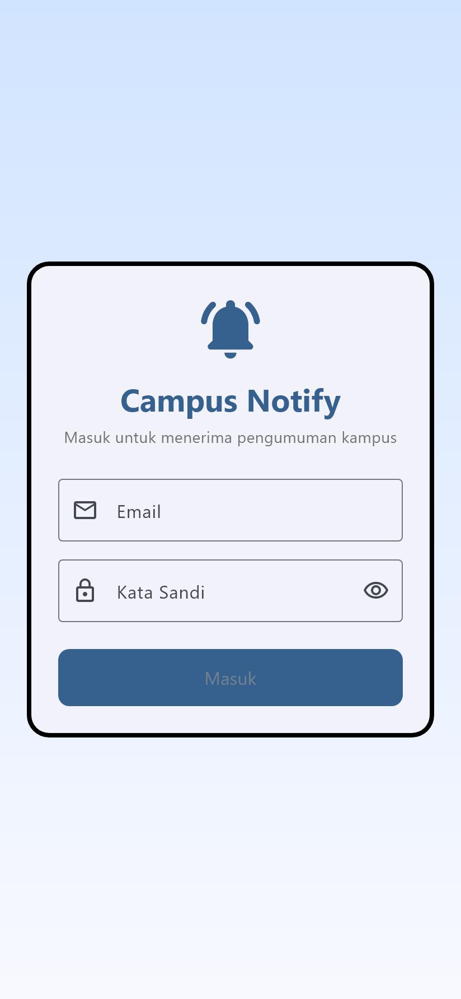
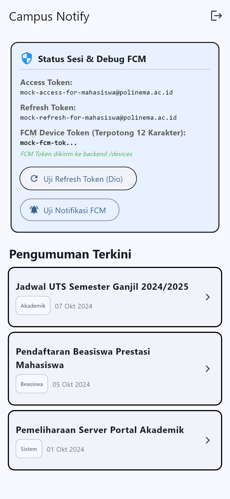
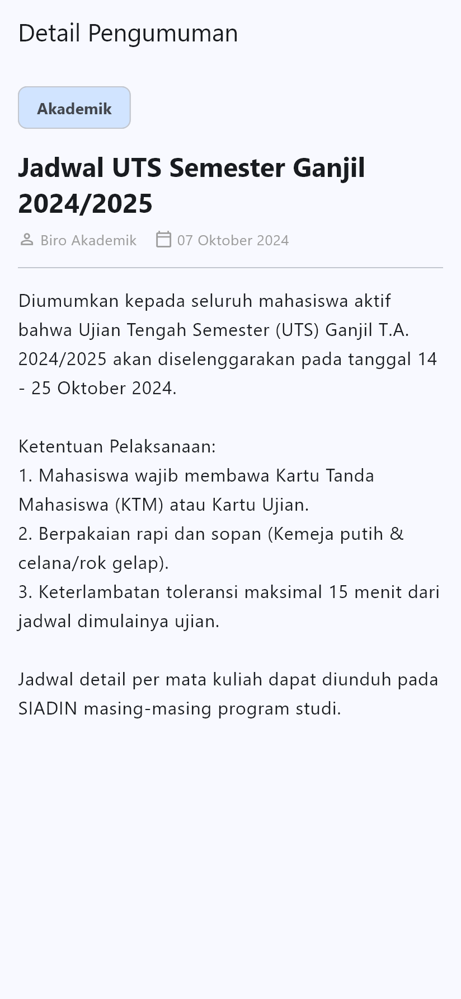

#  Week 6: Authentication, Security, & FCM (`campus_notify`)

## 🎯 Tujuan Pembelajaran
Setelah menyelesaikan rangkaian praktikum ini, mahasiswa mampu:
1. Memahami alur autentikasi berbasis token JWT serta perbedaan peran *ID Token*, *Access Token*, dan *Refresh Token*.
2. Menyimpan token secara aman menggunakan `flutter_secure_storage` (Android Keystore / iOS Keychain) dan menerapkan *automatic token refresh* transparan dengan Dio Interceptor.
3. Mengonfigurasi Firebase Cloud Messaging (FCM), mengelola perizinan notifikasi runtime (Android 13+ & iOS), dan menangani siklus hidup token (`getToken`, `onTokenRefresh`, `subscribeToTopic`).
4. Membedakan *notification payload* vs *data payload* serta menangani notifikasi di tiga status aplikasi (*foreground*, *background*, dan *terminated*).
5. Menerapkan deep linking ke halaman pengumuman spesifik (`/pengumuman/:id`) menggunakan GoRouter.
6. Menerapkan standar keamanan mobile OWASP: tidak menyimpan kredensial di SharedPreferences, tidak mencetak token di log publik, serta memotong (*masking*) token pada tampilan layar.

---

## 🔐 Praktikum 1: Login, Secure Storage, & Token Refresh Interceptor

### 1. Deskripsi & Arsitektur
Praktikum 1 memfokuskan autentikasi pengguna dengan pola keamanan modern:
- **`TokenStore`**: Memanfaatkan pustaka `flutter_secure_storage` yang mengenkripsi data menggunakan Keystore hardware di Android dan Keychain di iOS. Token tidak disimpan dalam berkas teks biasa seperti SharedPreferences.
- **`AuthRepository`**: Menangani otentikasi login serta pertukaran refresh token dengan access token baru.
- **`Dio Interceptor` (Auto Refresh 401)**: Interceptor Dio memonitor setiap HTTP request. Jika server merespons kode `401 Unauthorized` (karena access token kedaluwarsa):
  1. Interceptor mencegat error sebelum diteruskan ke UI.
  2. Membaca `refresh_token` dari `TokenStore`.
  3. Meminta `access_token` baru ke server secara asinkron.
  4. Menyimpan token baru ke `TokenStore`.
  5. Mengulang (*retry*) request yang sempat gagal dengan header `Authorization: Bearer <token_baru>`.
  6. Jika refresh token juga tidak valid, sesi dibersihkan dan pengguna diarahkan kembali ke halaman login.

### 2. Implementasi Kunci Dio Interceptor ([`lib/data/api_client.dart`](file:///c:/Users/louis/Semester%205a/244107020071-mobile-course/06-week-6-authentication-security-fcm/campus_notify/lib/data/api_client.dart))
```dart
onError: (e, handler) async {
  if (e.response?.statusCode == 401) {
    final refresh = await store.readRefresh();
    if (refresh == null) return handler.next(e);
    try {
      final renewed = await auth.refresh(refresh);
      await store.save(access: renewed, refresh: refresh);
      final retry = await dio.fetch(
        e.requestOptions..headers['Authorization'] = 'Bearer $renewed',
      );
      return handler.resolve(retry);
    } catch (_) {
      await store.clear(); // Bersihkan sesi jika refresh token kadaluarsa
    }
  }
  handler.next(e);
}
```

---

## 📡 Praktikum 2: FCM, Notification Permission, & Token Lifecycle

### 1. Deskripsi & Arsitektur
Praktikum 2 mengintegrasikan Firebase Cloud Messaging (FCM) untuk pengiriman pesan dari cloud ke perangkat:
- **Runtime Notification Permission**: Meminta izin pengguna secara eksplisit pada saat aplikasi dimulai (wajib pada Android 13+ / API 33+ dan iOS).
- **Registration Token Lifecycle**:
  - `getToken()`: Mengambil token registrasi unik perangkat.
  - `onTokenRefresh`: Mendengarkan pergantian token saat aplikasi di-reinstall, restore data, atau rotasi keamanan, lalu mengirim token terbarukan ke backend kampus (`POST /devices`).
  - `subscribeToTopic('pengumuman-kampus')`: Mendaftarkan perangkat ke kanal siaran massal untuk seluruh mahasiswa.
- **Masking Tampilan Token (Data Privacy)**: Demi keamanan informasi, token FCM dipotong menjadi maksimal 12 karakter pertama diikuti `...` (misalnya `mock-fcm-tok...`), mencegah tereksposnya kredensial sensitif dalam laporan.

### 2. Implementasi Kunci Token Lifecycle ([`lib/messaging/push_service.dart`](file:///c:/Users/louis/Semester%205a/244107020071-mobile-course/06-week-6-authentication-security-fcm/campus_notify/lib/messaging/push_service.dart))
```dart
Future<void> initFcmToken({
  required Future<void> Function(String token) onToken,
}) async {
  // 1. Ambil token perangkat awal
  final token = await FirebaseMessaging.instance.getToken();
  if (token != null) await onToken(token);

  // 2. Pantau event pembaruan token
  FirebaseMessaging.instance.onTokenRefresh.listen((newToken) async {
    await onToken(newToken);
  });

  // 3. Daftarkan perangkat ke topik pengumuman kampus
  await FirebaseMessaging.instance.subscribeToTopic('pengumuman-kampus');
}
```

---

## 🔔 Praktikum 3: Payload, 3 App State Handling, & Deep Linking

### 1. Payload Kombinasi: `notification + data`
Pengiriman pesan menggunakan format kombinasi:
- Bagian **`notification`** (`title`, `body`): Digunakan oleh sistem operasi untuk menampilkan visual banner saat aplikasi di luar layar.
- Bagian **`data`** (`route: /pengumuman/3`, `id: 3`): Membawa metadata rute deep linking untuk konsumsi internal aplikasi.

### 2. Matriks Penanganan 3 App State
Aplikasi dirancang agar dapat menangani pesan secara konsisten di semua status aplikasi:

| State Aplikasi | Kondisi Aplikasi | Komponen / Handler | Perilaku Notifikasi & Aksi Klik |
|---|---|---|---|
| **Foreground** | Aplikasi sedang dibuka dan aktif di layar | `FirebaseMessaging.onMessage` + `flutter_local_notifications` | Banner sistem tidak otomatis tampil di Android; dimunculkan manual menggunakan *local notification*. Diklik membuka `/pengumuman/:id`. |
| **Background** | Aplikasi di-minimize atau membuka aplikasi lain | OS System Tray + `FirebaseMessaging.onMessageOpenedApp` | Banner ditampilkan otomatis oleh Android/iOS. Saat notifikasi ditekan, aplikasi naik ke depan dan membuka `/pengumuman/:id`. |
| **Terminated** | Aplikasi ditutup total (*killed*) dari Recent Apps | OS System Tray + `FirebaseMessaging.instance.getInitialMessage` | Banner sistem tetap berada di status bar. Saat ditekan, aplikasi booting dan membaca pesan awal untuk membuka rute tujuan. |

---

## 🛠️ Refactoring Challenge & Keamanan Arsitektur

Sebagai bagian dari tantangan refactoring dan pemisahan tanggung jawab (*Separation of Concerns*):
1. **Sentralisasi Rute ([`lib/routes.dart`](file:///c:/Users/louis/Semester%205a/244107020071-mobile-course/06-week-6-authentication-security-fcm/campus_notify/lib/routes.dart))**:
   - Mendefinisikan konstanta rute (`AppRoutes.login`, `AppRoutes.home`, `AppRoutes.announcement`).
   - Menyediakan pure function `routeFromMessage(Map<String, dynamic> data)` yang dapat diuji tanpa dependensi framework.
2. **Abstraksi Error Dio ([`lib/data/api_errors.dart`](file:///c:/Users/louis/Semester%205a/244107020071-mobile-course/06-week-6-authentication-security-fcm/campus_notify/lib/data/api_errors.dart))**:
   - Fungsi `getFriendlyErrorMessage(DioException e)` menerjemahkan error 401, connection timeout, dan error 500 menjadi pesan bahasa Indonesia yang mudah dipahami pengguna tanpa membocorkan stack trace.
3. **Dokumentasi AI Challenge ([`docs/ai_challenge.md`](file:///c:/Users/louis/Semester%205a/244107020071-mobile-course/06-week-6-authentication-security-fcm/docs/ai_challenge.md))**:
   - Menyimpan prompt lengkap, checklist verifikasi, perbaikan manual top-level isolate handler `@pragma('vm:entry-point')`, serta penolakan penyimpanan token di SharedPreferences.

---

## 📸 Dokumentasi Bukti Pengujian (Screenshots & GIFs)

Berikut adalah rekaman animasi GIF hasil pengujian fitur aplikasi:

### 1. Form Login & Secure Storage (Praktikum 1)
  
*Keterangan: Alur pengisian kredensial login akun mahasiswa, validasi input, autentikasi sukses, serta penyimpanan access & refresh token secara otomatis ke hardware-backed Secure Storage.*

---

### 2. Automatic Token Refresh Interceptor (Praktikum 1)
  
*Keterangan: Simulasi HTTP 401 saat menekan tombol "Uji Refresh Token (Dio)". Dio Interceptor secara transparan meminta access token baru dan mengulang request tanpa mengeluarkan pengguna dari layar dashboard.*

---

### 3. Tampilan Masking FCM Token & Status Topik (Praktikum 2)
  
*Keterangan: Kartu Debug FCM menampilkan token registrasi yang telah dipotong menjadi 12 karakter pertama (`mock-fcm-tok...`) demi privasi dan keamanan data, serta status subskripsi topik `pengumuman-kampus` aktif.*

---

### 4. Simulasi Push Notification & Banner Masuk (Praktikum 2 & 3)
  
*Keterangan: Simulasi notifikasi pengumuman dari server/Firebase console masuk ke aplikasi, menampilkan banner notifikasi lokal di status bar.*

---

### 5. Deep Linking ke Detail Pengumuman (Praktikum 3)
  
*Keterangan: Notifikasi yang ditekan otomatis mengarahkan navigasi aplikasi ke rute `/pengumuman/3` dan menampilkan rincian pengumuman akademik sesuai payload `data.route`.*

---

## 🧪 Hasil Pengujian Otomatis (Testing & Static Analysis)

### 1. Unit Test Logika Auth & Push ([`test/auth_push_test.dart`](file:///c:/Users/louis/Semester%205a/244107020071-mobile-course/06-week-6-authentication-security-fcm/campus_notify/test/auth_push_test.dart))
Pengujian unit dijalankan tanpa dependensi Firebase sungguhan dengan hasil 100% lulus:
```bash
flutter test
```
```text
00:01 +9: All tests passed!
```
Daftar cakupan pengujian unit:
- `routeFromMessage` menangani rute kosong dan tanpa awalan slash.
- Payload data membawa ID pengumuman target secara akurat.
- Auth Provider membaca status sesi dari keberadaan access token.
- Refresh token kedaluwarsa membersihkan seluruh sesi lokal (*force logout*).
- `getFriendlyErrorMessage` memetakan kode HTTP 401, 500, timeout, dan offline.

### 2. Static Analysis Linting
```bash
flutter analyze
```
```text
Analyzing campus_notify...
No issues found! (ran in 1.4s)
```

---

## 💡 Tugas Refleksi

### Pertanyaan 1
> **Mengapa refresh token tidak boleh disimpan di SharedPreferences? Apa risikonya bila bocor?**

**Jawaban:**  
`SharedPreferences` di platform Android menyimpan data dalam bentuk file berkas XML teks biasa (*plaintext*) di direktori aplikasi `/data/data/<package_name>/shared_prefs/`, tanpa mekanisme enkripsi bawaan. Jika perangkat di-*root*, mengalami serangan malware berizin pembacaan file lokal, atau jika backup data ADB diaktifkan, berkas tersebut dapat diekstrak dengan sangat mudah.  
Risiko kebocoran *refresh token* sangat berbahaya karena *refresh token* memiliki masa berlaku yang panjang (misalnya 7 hingga 30 hari atau bahkan permanen sampai dicabut). Penyerang yang memiliki *refresh token* dapat terus menerus meminta *access token* baru dari server atas nama pengguna sah tanpa memerlukan kata sandi. Oleh karena itu, *refresh token* wajib disimpan di `FlutterSecureStorage` yang memanfaatkan Android Keystore System / iOS Keychain dengan proteksi enkripsi hardware AES-256.

---

### Pertanyaan 2
> **Apa yang rusak bila `onTokenRefresh` diabaikan selama satu semester perkuliahan?**

**Jawaban:**  
Token registrasi FCM tidak bersifat permanen; token dapat dirotasi dan diterbitkan ulang oleh Firebase dalam berbagai kondisi: ketika aplikasi di-restore pada perangkat baru, cache layanan Google Play diperbarui, aplikasi diinstal ulang, atau rotasi kunci berkala dari Google.  
Jika event `onTokenRefresh` diabaikan dan tidak dikirimkan kembali ke server kampus (`POST /devices`), server akan terus menyimpan token lama (*stale token*). Akibatnya:
1. Mahasiswa tidak akan pernah menerima pengumuman mendesak, jadwal ujian, atau notifikasi akademik baru setelah token lama menjadi invalid.
2. Server pengirim akan membuang sumber daya dan menerima error respon `registration-token-not-registered` dari FCM backend.

---

### Pertanyaan 3
> **Kapan memakai topik dan kapan memakai token perangkat? Beri contoh pesan kampus untuk masing-masing.**

**Jawaban:**  
- **Topic Messaging (`subscribeToTopic`)**: Digunakan untuk pengiriman pesan siaran (*broadcast/multicast*) ke banyak pengguna sekaligus berdasarkan kategori minat atau kelompok tanpa server perlu mencatat jutaan token individual.
  - *Contoh Pesan Kampus*:  
    - Topik `pengumuman-kampus`: "Pengumuman Libur Hari Raya Nasional dan Kalender Akademik Semester Genap."
    - Topik `kelas-ti-3a`: "Perubahan Ruang Kuliah Praktikum Pemrograman Mobile ke Lab Komputer 2."
- **Device Token (Direct Messaging)**: Digunakan untuk pengiriman notifikasi personal, privat, dan sensitif yang ditujukan khusus hanya untuk satu akun/perangkat tertentu.
  - *Contoh Pesan Kampus*:  
    - "Louis, pengajuan KRS Anda telah disetujui oleh Dosen Pembimbing Akademik."
    - "Pemberitahuan Tagihan Pembayaran UKT Semester 5 Berhasil Diverifikasi."
    - "Verifikasi Keamanan: Akun Anda baru saja login dari perangkat baru."

---

### Pertanyaan 4
> **Bagian mana dari draf AI yang Anda tolak atau perbaiki, dan mengapa?**

**Jawaban:**  
Pada pengerjaan [AI Challenge](docs/ai_challenge.md), kami menolak dan memperbaiki beberapa aspek dari kode yang disarankan oleh AI:
1. **Penolakan Background Handler di dalam Kelas**: AI awalnya membuat fungsi background handler sebagai method di dalam class `PushService`. Saran ini **ditolak** karena Dart VM menjalankan proses background notifikasi pada isolate terpisah. Arsitektur Flutter mewajibkan background handler berupa fungsi *top-level* independen yang dianotasi `@pragma('vm:entry-point')` agar tidak gagal dieksekusi oleh engine saat aplikasi ditutup.
2. **Penolakan Penggunaan BuildContext pada Stream Listener**: AI mencoba memanggil `context.go()` langsung dari stream listener FCM. Kami memperbaiki arsitektur tersebut dengan mendengarkan rute melalui router global tanpa mengandalkan BuildContext yang rentan terhadap exception *widget deactivated*.
3. **Penolakan Logging Token Mentah**: AI menyertakan `print(token)` secara penuh pada console. Ini melanggar prinsip *security hygiene*. Kami menggantinya dengan fungsi masking (12 karakter + `...`) agar kredensial rahasia tidak bocor pada log maupun tangkapan layar.

---

## 🚀 Panduan Menjalankan Aplikasi

1. Pindah ke direktori proyek:
   ```bash
   cd campus_notify
   ```
2. Pastikan seluruh dependensi terpasang:
   ```bash
   flutter pub get
   ```
3. Jalankan pengujian unit:
   ```bash
   flutter test
   ```
4. Jalankan aplikasi pada emulator atau perangkat fisik:
   ```bash
   flutter run
   ```
