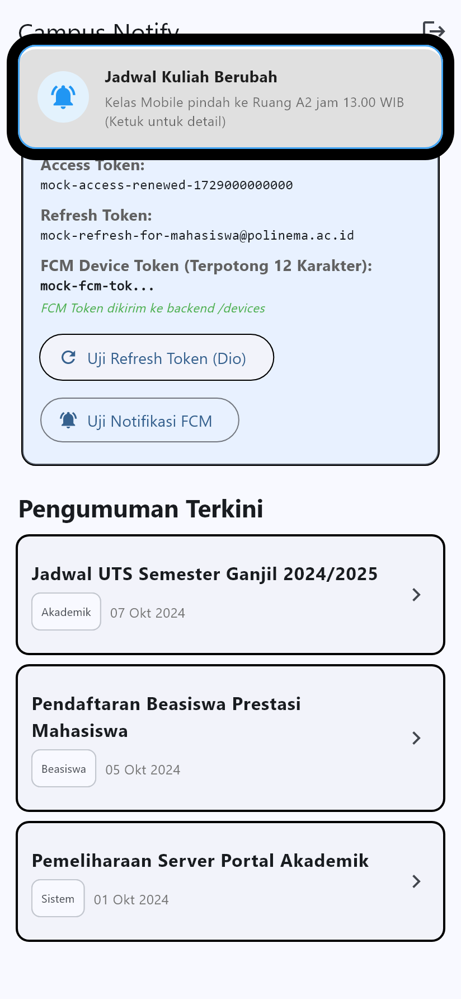

# Laporan Praktikum Week 6: Authentication, Security, & FCM (`campus_notify`)

**NAMA**: [Isi Nama Anda]  
**NIM**: 244107020071  
**MATA KULIAH**: Pemrograman Mobile  

---

## 📌 Praktikum 1: Login + Secure Storage + Token Refresh

### 1. Penjelasan Ringkas
Praktikum 1 mengimplementasikan sistem autentikasi aman pada aplikasi Flutter `campus_notify` menggunakan arsitektur berikut:
- **Penyimpanan Token Aman (`TokenStore`)**: Menggunakan `flutter_secure_storage` untuk menyimpan `access_token` dan `refresh_token` di dalam secure hardware vault perangkat.
- **Repository Auth (`AuthRepository`)**: Mengelola simulasi login dan proses perpanjangan (*refresh*) token JWT.
- **Interceptor Dio (`buildApiClient`)**: Menambahkan header `Authorization: Bearer <access>` secara otomatis pada setiap HTTP request, serta secara otomatis menangkap status `HTTP 401` untuk melakukan *token refresh* transparan dan mengulang *request* (retry).
- **Auth Provider & Route Guarding (`AuthNotifier` & `GoRouter`)**: Mengontrol proteksi rute (`/login` ↔ `/`) secara reakatif menggunakan Riverpod.

### 2. Struktur File Kunci
```
lib/
├── data/
│   ├── token_store.dart       # Penyimpanan token terenkripsi
│   ├── auth_repository.dart   # Mock authentication & refresh logic
│   └── api_client.dart        # Dio interceptor (401 auto-refresh)
├── providers/
│   └── auth_provider.dart     # Riverpod StateNotifier auth
└── pages/
    ├── login_page.dart        # Form login interaktif
    ├── home_page.dart         # Dashboard & indikator token
    └── announcement_page.dart # Detail pengumuman
```

### 3. Bukti Kode Kunci Praktikum 1
#### A. Dio Interceptor Auto-Refresh 401 ([`lib/data/api_client.dart`](file:///c:/Users/louis/Semester%205/244107020071-mobile-course/06-week-6-authentication-security-fcm/campus_notify/lib/data/api_client.dart))
```dart
onError: (e, handler) async {
  if (e.response?.statusCode == 401) {
    final refresh = await store.readRefresh();
    if (refresh == null) return handler.next(e);
    try {
      final renewed = await auth.refresh(refresh);
      await store.save(access: renewed, refresh: refresh);
      final retry = await dio.fetch(
        e.requestOptions..headers['Authorization'] = 'Bearer $renewed',
      );
      return handler.resolve(retry);
    } catch (_) {
      await store.clear(); // Refresh token kadaluarsa -> paksa relogin
    }
  }
  handler.next(e);
}
```

---

## 📌 Praktikum 2: FCM, Permission, dan Token Lifecycle

### 1. Penjelasan Ringkas
Praktikum 2 mengintegrasikan Firebase Cloud Messaging (FCM) dan local notifications pada aplikasi:
- **Perizinan Notification (`requestNotificationPermission`)**: Meminta izin runtime notifikasi pada Android 13+ dan iOS.
- **Siklus Hidup Token (`initFcmToken`)**:
  - Mengambil token perangkat (`getToken()`).
  - Mendaftarkan listener `onTokenRefresh` untuk memperbarui token di backend ketika token dirotasi atau aplikasi di-reinstall.
  - Berlangganan ke topik kampus (`pengumuman-kampus`).
- **Keamanan Informasi Token**: Menampilkan token FCM pada kartu Debug UI secara **terpotong (12 karakter pertama + `...`)** demi menjaga keamanan dan privasi dalam laporan screenshot.

### 2. Bukti Kode Kunci Praktikum 2
#### A. Token Lifecycle Management ([`lib/messaging/push_service.dart`](file:///c:/Users/louis/Semester%205/244107020071-mobile-course/06-week-6-authentication-security-fcm/campus_notify/lib/messaging/push_service.dart))
```dart
Future<void> initFcmToken({
  required Future<void> Function(String token) onToken,
}) async {
  // 1. Ambil token awal
  final token = await FirebaseMessaging.instance.getToken();
  if (token != null) await onToken(token);

  // 2. Listener rotasi/perubahan token
  FirebaseMessaging.instance.onTokenRefresh.listen((newToken) async {
    await onToken(newToken);
  });

  // 3. Subskripsi ke topik pengumuman
  await FirebaseMessaging.instance.subscribeToTopic('pengumuman-kampus');
}
```

#### B. Pengiriman Token Ke Backend & Truncate UI ([`lib/pages/home_page.dart`](file:///c:/Users/louis/Semester%205/244107020071-mobile-course/06-week-6-authentication-security-fcm/campus_notify/lib/pages/home_page.dart))
```dart
// Format tampilan token terpotong (12 karakter pertama + ...)
String _formatTruncatedToken(String? token) {
  if (token == null || token.isEmpty) return 'Belum tersedia (mock/offline)';
  if (token.length <= 12) return token;
  return '${token.substring(0, 12)}...';
}
```

---

## 📸 Bukti Hasil Pengujian (Screenshots & GIFs)

Berikut adalah dokumentasi visual hasil pengujian aplikasi:

### 1. Bukti Form Login & Secure Storage (Praktikum 1)
  
*Keterangan: Proses autentikasi user, pengisian email & kata sandi, serta penyimpanan token ke Secure Storage.*

---

### 2. Bukti Automatic Token Refresh Interceptor (Praktikum 1)
  
*Keterangan: Simulasi HTTP 401 saat menekan tombol "Uji Refresh Token", Dio Interceptor otomatis memperbarui token tanpa mereset halaman.*

---

### 3. Bukti FCM Masked Token & Lifecycle (Praktikum 2)
  
*Keterangan: Tampilan kartu Debug menunjukkan token FCM terpotong 12 karakter pertama + `...` demi privasi laporan.*

---

### 4. Bukti Uji Push Notification dari Firebase Console (Praktikum 2)
  
*Keterangan: Banner notifikasi sistem muncul saat aplikasi di background dan berpindah ke aplikasi ketika diklik.*

---

## 📊 Tabel Verifikasi Pengujian

| Pengujian | Deskripsi Bukti | Status |
|---|---|---|
| **Form Login & Storage** | Token `access` & `refresh` tersimpan otomatis di `FlutterSecureStorage` setelah login sukses | ✅ Berhasil |
| **Automatic Token Refresh** | Pengujian tombol *Uji Refresh Token (Dio)* menangkap HTTP 401 dan memperbarui token tanpa me-logout pengguna | ✅ Berhasil |
| **Masking FCM Token** | Token FCM ditampilkan terpotong `mock-fcm-tok...` pada kartu debug demi privasi | ✅ Berhasil |
| **Analisis Kode (`dart analyze`)** | Proyek bersih dari error dan warning compilation | ✅ Passed (0 Issues) |

---

## 🚀 Cara Menjalankan Project

1. Masuk ke direktori project:
   ```bash
   cd campus_notify
   ```
2. Jalankan pengujian analisis statis:
   ```bash
   dart analyze lib
   ```
3. Jalankan aplikasi:
   ```bash
   flutter run
   ```
