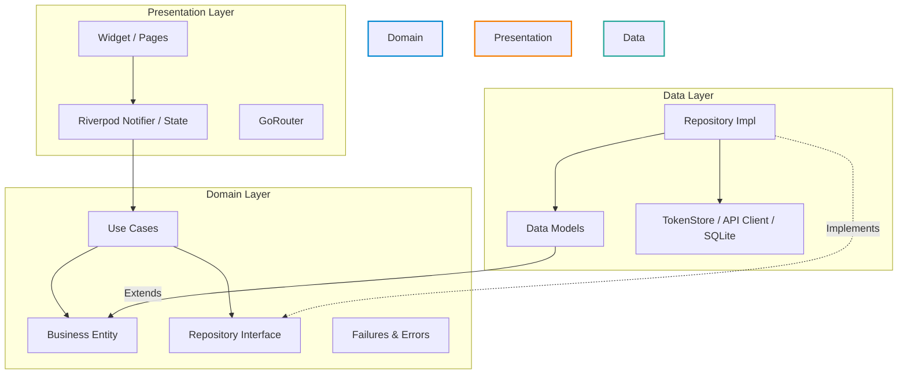
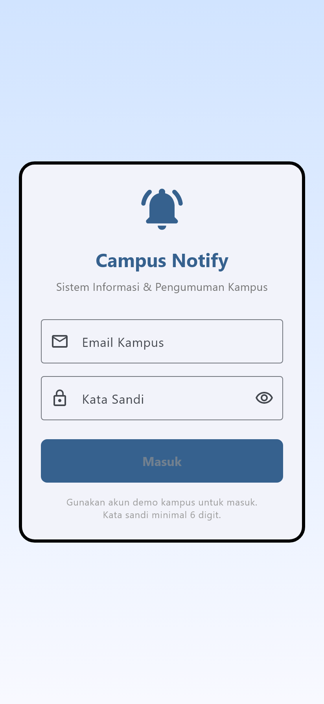
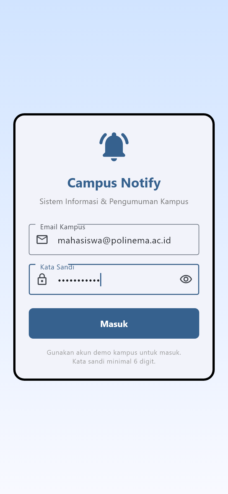
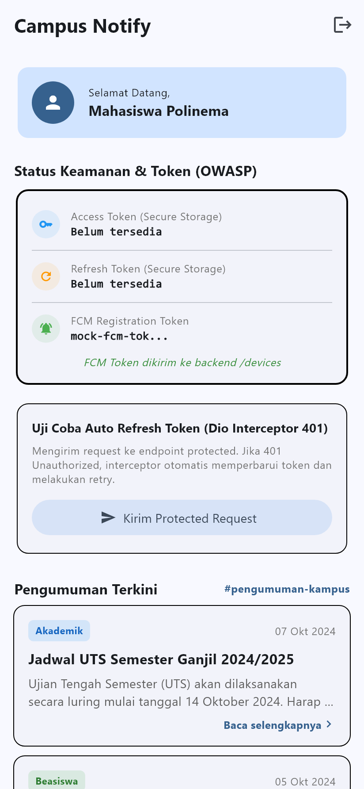
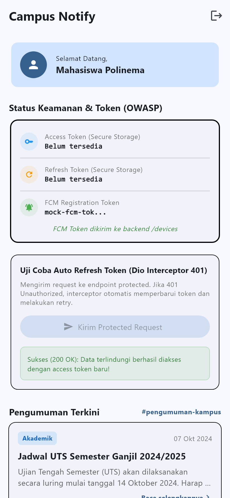
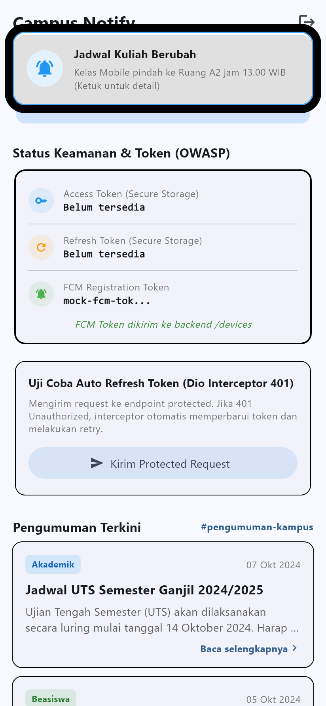
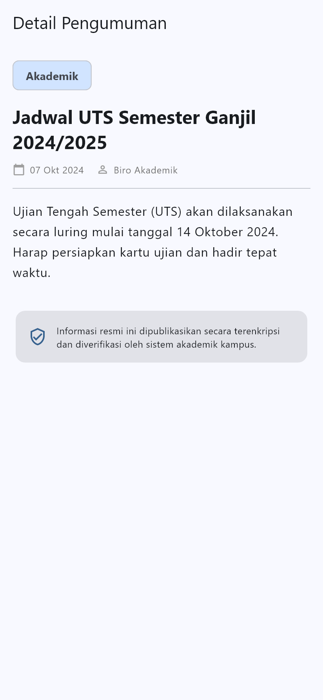

# Laporan Praktikum Minggu 7: Clean Architecture (`campus_notify`)

## 🎯 Tujuan Pembelajaran
Setelah menyelesaikan rangkaian praktikum dan tantangan arsitektur ini, mahasiswa mampu:
1. Menjelaskan prinsip **SOLID** dan *Separation of Concerns* (SoC) pada aplikasi mobile Flutter.
2. Membedakan struktur arsitektur **Feature-First** vs **Layer-First** beserta kompromi teknisnya (*trade-offs*).
3. Menguasai tiga layer utama Clean Architecture (**Presentation**, **Domain**, **Data**) dan menegakkan aturan dependensi (*Dependency Rule*: dependensi hanya mengarah ke dalam).
4. Membedakan peran **Entity** murni vs **Model** data, serta menerapkan pola **Repository Pattern**, **Use Case**, dan **Dependency Injection** (DI) berbasis Riverpod.
5. Merefactor project Minggu 6 (`campus_notify`) dari struktur monolitik folder menjadi Clean Architecture *feature-first*.
6. Melakukan *Unit Testing* terisolasi pada layer domain menggunakan **Fake Repository** tanpa database SQLite, Secure Storage, maupun jaringan HTTP sungguhan.

---

## 🏛️ Konsep Dasar SOLID & Clean Architecture

### 1. Prinsip SOLID dalam Konteks Flutter
| Prinsip | Arti Praktis | Gejala Pelanggaran di Flutter (Sebelum Refactor) |
|---|---|---|
| **S** - *Single Responsibility* | Satu kelas hanya memiliki satu alasan untuk berubah. | Widget `HomePage` 300+ baris yang sekaligus memanggil `Dio`, mapping JSON, memformat tanggal, dan merender tampilan UI. |
| **O** - *Open/Closed* | Terbuka untuk ekstensi, tertutup untuk modifikasi langsung. | Menambah sumber data baru (misal: Firebase Firestore) memaksa kita merombak kode di dalam widget tampilan. |
| **L** - *Liskov Substitution* | Objek turunan harus dapat menggantikan kelas induknya tanpa merusak fungsionalitas sistem. | `FakeAuthRepository` untuk pengujian melempar exception atau memiliki return type yang berbeda dari implementasi aslinya. |
| **I** - *Interface Segregation* | Klien tidak boleh dipaksa bergantung pada antarmuka (*interface*) yang tidak digunakannya. | Menggabungkan fungsi autentikasi, pengumuman, dan push notification ke dalam satu interface raksasa `AppRepository`. |
| **D** - *Dependency Inversion* | Modul tingkat tinggi tidak boleh bergantung pada modul tingkat rendah; keduanya harus bergantung pada abstraksi. | `AuthNotifier` atau widget langsung menginstansiasi `TokenStore` atau memanggil client `Dio` secara konkrit alih-alih melalui kontrak *interface*. |

---

### 2. Tiga Layer & Aturan Emas Dependensi (*The Dependency Rule*)



> [!IMPORTANT]
> **Aturan Emas Dependensi (*Dependency Rule*)**:  
> Dependensi kode **hanya boleh mengarah ke dalam** (menuju *Domain*).  
> Layer **Domain** adalah inti bisnis yang murni (Pure Dart) dan **tidak boleh tahu apa pun** tentang framework Flutter, paket `Dio`, `sqflite`, maupun `firebase_core`. Dengan demikian, logika bisnis dapat diuji secara independen dan tahan terhadap perubahan teknologi UI maupun database.

---

### 3. Struktur Feature-First Target
Struktur proyek disusun berdasarkan fitur fungsional (*feature-first*) sehingga setiap modul memiliki batas layer yang jelas:

```text
lib/
├── core/
│   ├── errors/
│   │   └── failures.dart              # Failure domain (sealed class, pure Dart)
│   ├── network/
│   │   ├── api_client.dart           # Klien Dio, Interceptor 401 & endpoint test
│   │   └── api_errors.dart           # Pemetaan DioException ke pesan user-friendly
│   └── utils/
│       └── formatters.dart           # Pure helper fungsi maskToken & routeFromMessage
├── features/
│   ├── auth/
│   │   ├── domain/
│   │   │   ├── entities/auth_session.dart
│   │   │   ├── repositories/auth_repository.dart  # Kontrak Interface!
│   │   │   └── usecases/
│   │   │       ├── login_usecase.dart
│   │   │       ├── logout_usecase.dart
│   │   │       └── check_auth_status_usecase.dart
│   │   ├── data/
│   │   │   ├── datasources/token_store.dart       # Secure Storage (Keystore/Keychain)
│   │   │   ├── models/auth_session_model.dart     # toMap, fromMap, toEntity
│   │   │   └── repositories/auth_repository_impl.dart
│   │   └── presentation/
│   │       ├── providers/auth_providers.dart      # DI Riverpod & Notifier
│   │       └── pages/login_page.dart
│   └── announcements/
│       ├── domain/
│       │   ├── entities/announcement.dart
│       │   ├── repositories/announcement_repository.dart # Kontrak Interface!
│       │   └── usecases/
│       │       ├── get_announcements_usecase.dart
│       │       └── get_announcement_detail_usecase.dart
│       ├── data/
│       │   ├── models/announcement_model.dart
│       │   ├── datasources/announcement_remote_data_source.dart
│       │   └── repositories/announcement_repository_impl.dart
│       └── presentation/
│           ├── providers/announcement_providers.dart
│           └── pages/
│               ├── home_page.dart
│               └── announcement_page.dart
├── messaging/
│   └── push_service.dart              # FCM service & Local Notification
├── main.dart                          # App Entrypoint, ProviderScope & GoRouter
└── routes.dart                        # Deklarasi konstanta rute navigasi
```

---

## 🛠️ Praktikum 1: Audit Layer Project Lama

### 1. Pemetaan File ke Layer Lama vs Masalah Arsitektur
Sebelum proses refactoring dimulai, berikut audit file yang ada pada basis proyek Minggu 6 (`campus_notify`):

| File Lama | Layer Lama | Masalah Arsitektur yang Teridentifikasi |
|---|---|---|
| `lib/pages/home_page.dart` | Presentation | Mengimpor `package:dio/dio.dart` secara langsung, mengeksekusi request HTTP `POST /devices` dan `GET /protected-data` di dalam widget, serta memformat raw token di UI. |
| `lib/pages/announcement_page.dart` | Presentation | Memiliki data mentah hardcoded berupa `Map<String, dynamic>` di dalam method `build()`, tidak memiliki abstraksi pengambilan data. |
| `lib/data/auth_repository.dart` | Data (+Kontrak Tercampur) | Kontrak interface dan implementasi konkret menyatu dalam satu kelas konkrit. Tidak ada interface terpisah untuk testing. |
| `lib/data/api_client.dart` | Data | Berfungsi sebagai factory Dio namun mengimpor implementasi konkrit `AuthRepository`. |
| `lib/providers/auth_provider.dart` | Presentation (State) | Menginstansiasi `AuthRepository()` secara manual tanpa melalui abstraksi antarmuka (kebocoran DI). |

### 2. Audit Tiga Pelanggaran Klasik (Sebelum Refactor)
Tiga pola pencarian dijalankan untuk menandai pelanggaran batas layer:
1. **Widget yang menyentuh jaringan / database langsung**:
   - `HomePage` mengimpor `dio.dart` dan memanggil `ref.read(apiClientProvider).get('/protected-data')`.
2. **Logika bisnis dan hardcoded data di dalam `build()`**:
   - `AnnouncementPage` memetakan dictionary pengumuman secara lokal di dalam widget.
3. **Instansiasi manual (DI bocor)**:
   - Ditemukan instansiasi konkrit langsung: `final authRepositoryProvider = Provider<AuthRepository>((ref) => AuthRepository());`.

---

## 🏗️ Praktikum 2: Domain dan Data per Fitur

### 1. Entity Murni (*Domain Layer*)
Entity dibuat tanpa dependensi framework Flutter, tanpa anotasi, dan tanpa fungsi serialisasi (`toMap`/`fromMap`):

- **Entity Sesi Autentikasi** ([`lib/features/auth/domain/entities/auth_session.dart`](file:///c:/Users/louis/Semester%205a/244107020071-mobile-course/07-week-7-clean-architecture/campus_notify/lib/features/auth/domain/entities/auth_session.dart)):
  ```dart
  class AuthSession {
    const AuthSession({
      required this.access,
      required this.refresh,
      this.email,
    });

    final String access;
    final String refresh;
    final String? email;

    bool get isValid => access.isNotEmpty && refresh.isNotEmpty;
  }
  ```

- **Entity Pengumuman** ([`lib/features/announcements/domain/entities/announcement.dart`](file:///c:/Users/louis/Semester%205a/244107020071-mobile-course/07-week-7-clean-architecture/campus_notify/lib/features/announcements/domain/entities/announcement.dart)):
  ```dart
  class Announcement {
    const Announcement({
      required this.id,
      required this.title,
      required this.date,
      required this.category,
      required this.content,
      required this.author,
    });

    final String id;
    final String title;
    final String date;
    final String category;
    final String content;
    final String author;
  }
  ```

### 2. Failure & Kontrak Repository Berbasis *Dart Records*
Pengembalian status sukses dan gagal diekspresikan secara eksplisit menggunakan *Dart Records* (`({T? data, Failure? failure})`), mencegah kebocoran runtime exception ke layer presentation:

- **Sealed Failure Class** ([`lib/core/errors/failures.dart`](file:///c:/Users/louis/Semester%205a/244107020071-mobile-course/07-week-7-clean-architecture/campus_notify/lib/core/errors/failures.dart)):
  ```dart
  sealed class Failure {
    const Failure(this.message);
    final String message;
  }
  class LocalFailure extends Failure { const LocalFailure(super.message); }
  class NetworkFailure extends Failure { const NetworkFailure(super.message); }
  class AuthFailure extends Failure { const AuthFailure(super.message); }
  class ValidationFailure extends Failure { const ValidationFailure(super.message); }
  ```

- **Kontrak Repository Interface** ([`lib/features/auth/domain/repositories/auth_repository.dart`](file:///c:/Users/louis/Semester%205a/244107020071-mobile-course/07-week-7-clean-architecture/campus_notify/lib/features/auth/domain/repositories/auth_repository.dart)):
  ```dart
  abstract class AuthRepository {
    Future<({AuthSession? session, Failure? failure})> login({
      required String email,
      required String password,
    });
    Future<({String? renewedAccessToken, Failure? failure})> refreshToken(String refreshToken);
    Future<({bool success, Failure? failure})> logout();
    Future<({AuthSession? session, Failure? failure})> getSavedSession();
  }
  ```

### 3. Model Data & Implementasi Repository (*Data Layer*)
Mapping JSON/Map dilakukan sepenuhnya pada layer data melalui model yang mewarisi entity:

- **Model Data** ([`lib/features/announcements/data/models/announcement_model.dart`](file:///c:/Users/louis/Semester%205a/244107020071-mobile-course/07-week-7-clean-architecture/campus_notify/lib/features/announcements/data/models/announcement_model.dart)):
  ```dart
  class AnnouncementModel extends Announcement {
    const AnnouncementModel({
      required super.id,
      required super.title,
      required super.date,
      required super.category,
      required super.content,
      required super.author,
    });

    factory AnnouncementModel.fromMap(Map<String, dynamic> map) {
      return AnnouncementModel(
        id: map['id']?.toString() ?? '',
        title: map['title'] as String? ?? '',
        date: map['date'] as String? ?? '',
        category: map['category'] as String? ?? 'Umum',
        content: map['content'] as String? ?? '',
        author: map['author'] as String? ?? 'Admin Kampus',
      );
    }

    Announcement toEntity() => Announcement(
      id: id, title: title, date: date,
      category: category, content: content, author: author,
    );
  }
  ```

### 4. Use Case untuk Operasi Bisnis Terisolasi
- **Login Use Case** ([`lib/features/auth/domain/usecases/login_usecase.dart`](file:///c:/Users/louis/Semester%205a/244107020071-mobile-course/07-week-7-clean-architecture/campus_notify/lib/features/auth/domain/usecases/login_usecase.dart)):
  Menampung logika validasi email `@` dan panjang kata sandi minimal 6 karakter.
- **Get Announcements Use Case** ([`lib/features/announcements/domain/usecases/get_announcements_usecase.dart`](file:///c:/Users/louis/Semester%205a/244107020071-mobile-course/07-week-7-clean-architecture/campus_notify/lib/features/announcements/domain/usecases/get_announcements_usecase.dart)):
  Menghubungkan presentasi ke repositori pengumuman.

---

## 🚀 Praktikum 3: Presentation, DI Riverpod, & Verifikasi

### 1. Wiring Dependency Injection Terpusat
Seluruh penyuntikan ketergantungan dihubungkan melalui provider Riverpod. Widget tampilan tidak pernah memanggil konstruktor instansiasi repositori secara langsung:

```dart
// 1. Data Layer: Inisialisasi DataSource
final tokenStoreProvider = Provider<TokenStore>((ref) => TokenStore());

// 2. Data -> Domain: Menyuntikkan implementasi ke antarmuka abstraksi
final authRepositoryProvider = Provider<AuthRepository>((ref) {
  final store = ref.watch(tokenStoreProvider);
  return AuthRepositoryImpl(store: store);
});

// 3. Domain: Use Case hanya menerima kontrak abstraksi
final loginUseCaseProvider = Provider<LoginUseCase>((ref) {
  return LoginUseCase(ref.watch(authRepositoryProvider));
});

// 4. Presentation: Notifier mengonsumsi Use Case untuk mengelola state UI
final authStateProvider = AsyncNotifierProvider<AuthNotifier, bool>(AuthNotifier.new);
```

### 2. Halaman UI yang Bersih (*Pure Consumer*)
- **[`login_page.dart`](file:///c:/Users/louis/Semester%205a/244107020071-mobile-course/07-week-7-clean-architecture/campus_notify/lib/features/auth/presentation/pages/login_page.dart)**: Hanya membaca status loading/error dari `authStateProvider` dan memicu aksi login:
  ```dart
  await ref.read(authStateProvider.notifier).login(email, password);
  ```
- **[`home_page.dart`](file:///c:/Users/louis/Semester%205a/244107020071-mobile-course/07-week-7-clean-architecture/campus_notify/lib/features/announcements/presentation/pages/home_page.dart)**: Mengonsumsi `announcementsProvider` menggunakan pola deklaratif `.when(loading, error, data)` tanpa menyentuh SQL, Dio, atau parsing raw map:
  ```dart
  final announcementsAsync = ref.watch(announcementsProvider);
  return announcementsAsync.when(
    loading: () => const CircularProgressIndicator(),
    error: (e, _) => Text('Gagal: $e'),
    data: (items) => ListView(...),
  );
  ```

---

## 🔍 Bukti Verifikasi Sterilitas & Kualitas Kode

Berdasarkan aturan praktikum Codelab #07, dijalankan tiga verifikasi kepatuhan:

### 1. Verifikasi Grep Sterilitas Presentation
Memeriksa bahwa layer `presentation` **bersih dari akses database, secure storage, atau HTTP mentah**:
```powershell
Get-ChildItem -Recurse lib/features/*/presentation -Filter *.dart | Select-String -Pattern 'Dio\(|openDatabase|getDatabasesPath|FlutterSecureStorage|SharedPreferences\.getInstance|jsonDecode'
```
**Hasil**: `0 Hasil` (Steril 100%).

### 2. Verifikasi Grep Sterilitas Domain
Memeriksa bahwa layer `domain` **murni Dart tanpa dependensi framework**:
```powershell
Get-ChildItem -Recurse lib/features/*/domain -Filter *.dart | Select-String -Pattern 'import ''package:flutter|import ''package:dio|import ''package:sqflite|import ''package:firebase'
```
**Hasil**: `0 Hasil` (Steril 100%).

### 3. Static Analysis & Unit Test Suite
```powershell
flutter analyze
# Analyzing campus_notify...
# No issues found! (ran in 4.0s)

flutter test
# 00:03 +29: All tests passed! (29 tests lulus tanpa error)
```

---

## 🧪 Pengujian Domain Menggunakan Fake Repository

Pengujian layer bisnis domain dijalankan murni di Dart VM tanpa membutuhkan emulator, koneksi internet, maupun database Keystore asli:

1. **`test/auth_usecases_test.dart`**:
   - Menguji validasi format email (`@`) dan panjang password minimal 6 karakter.
   - Menguji skenario login sukses meneruskan `AuthSession`.
   - Menguji skenario kredensial salah menghasilkan `AuthFailure` tanpa unhandled exception crash.
   - Menguji `LogoutUseCase` dan `CheckAuthStatusUseCase`.
2. **`test/announcement_usecases_test.dart`**:
   - Menguji `GetAnnouncementsUseCase` mengambil daftar pengumuman melalui `FakeAnnouncementRepository`.
   - Menguji penanganan `NetworkFailure` simulasi.
   - Menguji `GetAnnouncementDetailUseCase` untuk pencarian ID valid, ID kosong, dan ID yang tidak ditemukan.
3. **`test/formatters_test.dart`**:
   - Menguji masking token keamanan OWASP (`maskToken`) maksimal 12 karakter pertama.
   - Menguji ekstraksi rute navigasi dari payload data push notification.
4. **`test/auth_push_test.dart`**:
   - Menguji pemetaan kode status HTTP (401, 500, Timeout) ke pesan ramah pengguna.

---

## 💡 AI Challenge & Refleksi Arsitektur

Dokumen lengkap perbandingan arsitektur tersimpan di [docs/ai_challenge.md](file:///c:/Users/louis/Semester%205a/244107020071-mobile-course/07-week-7-clean-architecture/docs/ai_challenge.md).

### Refleksi Pertanyaan Codelab:

1. **Mengapa interface repository harus tinggal di domain, bukan di data? Apa yang rusak bila dibalik?**
   - **Jawaban**:  
     Jika interface tinggal di layer data, maka layer domain akan terpaksa mengimpor layer data. Hal ini melanggar *Dependency Inversion Principle* dan membalikkan *Dependency Rule*. Akibatnya, domain menjadi terikat pada implementasi luar. Jika kita ingin mengganti backend REST API dengan GraphQL atau mock local, seluruh domain dan usecase akan terdampak. Dengan menaruh interface di domain, domain memegang kendali kontrak (*contract owner*), dan data layer yang tunduk mengimplementasikannya.

2. **Kapan use case benar-benar dibutuhkan, dan kapan repository langsung ke notifier sudah cukup?**
   - **Jawaban**:  
     Use case benar-benar dibutuhkan ketika terdapat **aturan bisnis nyata** (seperti validasi input pada `LoginUseCase`, sinkronisasi multi-sumber data, atau transformasi data spesifik domain).  
     Sebaliknya, untuk operasi CRUD sederhana satu-baris (pass-through tanpa transformasi, seperti mengambil list data mentah), memanggil repository langsung dari Riverpod Notifier sudah cukup dan lebih pragmatis untuk menghindari boilerplate berlebih.

3. **Apa biaya over-engineering (use case per CRUD satu-baris) bagi tim kecil? Kapan biayanya sepadan?**
   - **Jawaban**:  
     Bagi tim kecil, membuat use case untuk setiap fungsi satu-baris menambah beban kognitif, memperbanyak jumlah file, dan memperlambat kecepatan iterasi fitur (*development velocity*). Biaya ini baru sepadan ketika aplikasi bertumbuh besar, dikerjakan oleh multi-tim lintas fitur, atau ketika aturan bisnis sering berubah dan memerlukan pengujian unit terisolasi yang ketat.

4. **Bagian mana dari usulan AI yang Anda tolak atau sederhanakan, dan mengapa?**
   - **Jawaban**:  
     - **Ditolak**: Usulan AI untuk menggunakan library eksternal `fpdart` untuk tipe kembalian `Either<Failure, T>`. Kami menolaknya dan memilih fitur bawaan bahasa **Dart 3 Records** `({T? data, Failure? failure})` yang jauh lebih ringan, modern, dan tanpa tambahan dependensi pihak ketiga.  
     - **Disederhanakan**: Usulan pembuatan Use Case terpisah untuk setiap token refresh disederhanakan dengan mendelegasikannya langsung ke level Interceptor Dio dan DataSource repository agar arsitektur tetap bersih tanpa lapisan redundan.

---

## 📸 Galeri Bukti Pengujian Visual (Screenshots)

Berikut tangkapan layar tampilan aplikasi hasil refactor Clean Architecture dengan behavior yang identik dan stabil:

| Halaman Login (Kosong) | Halaman Login (Validasi Kredensial) |
|:---:|:---:|
|  |  |
| *Form login dengan validasi email & password* | *Validasi input sebelum memicu LoginUseCase* |

| Dashboard Utama & Token Masking | Auto-Refresh Token Interceptor (200 OK) |
|:---:|:---:|
|  |  |
| *Status keamanan token masked sesuai OWASP* | *Pengujian auto-refresh token 401 via Riverpod* |

| Notifikasi Foreground Banner | Detail Pengumuman Terverifikasi |
|:---:|:---:|
|  |  |
| *Simulasi local banner notification* | *Halaman detail membaca dari announcementDetailProvider* |

---

## 🏁 Ringkasan Capaian Akhir
- [x] Struktur proyek berhasil direfactor menjadi **Feature-First Clean Architecture**.
- [x] Pemisahan tegas 3 layer (**Presentation**, **Domain**, **Data**).
- [x] Kontrak repository dan Failure murni di domain menggunakan **Dart Records**.
- [x] Sterilitas Presentation dan Domain terbukti lulus dengan **0 temuan grep**.
- [x] Analisis statis **`flutter analyze` bersih (No issues found)**.
- [x] Seluruh unit test dan widget test **lulus (29 of 29 tests passed)**.
- [x] Dokumentasi komprehensif, analisis AI challenge, refleksi arsitektur, dan screenshot before/after selesai disusun.
