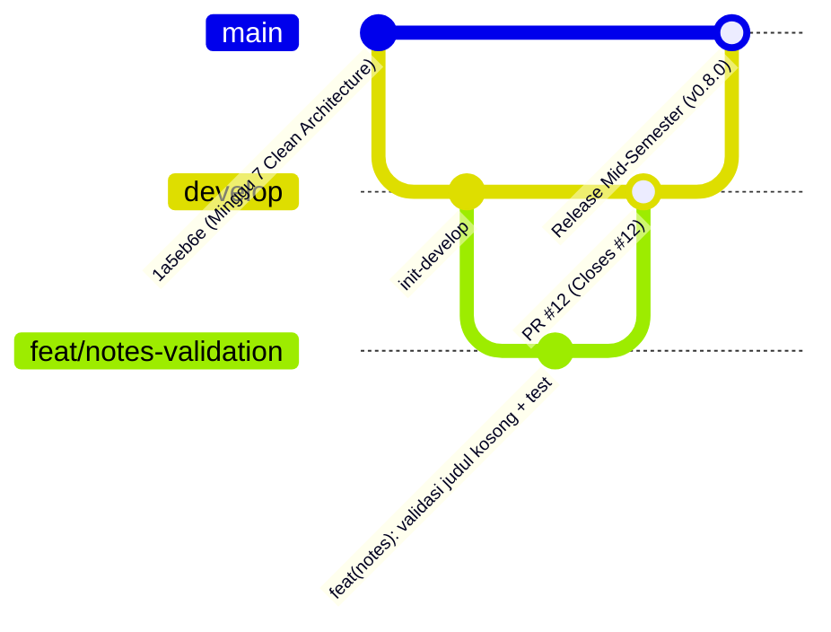
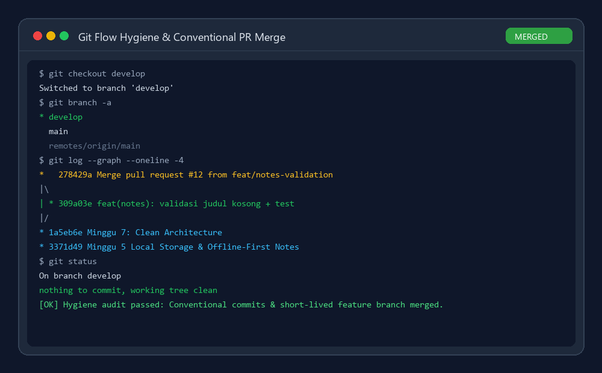
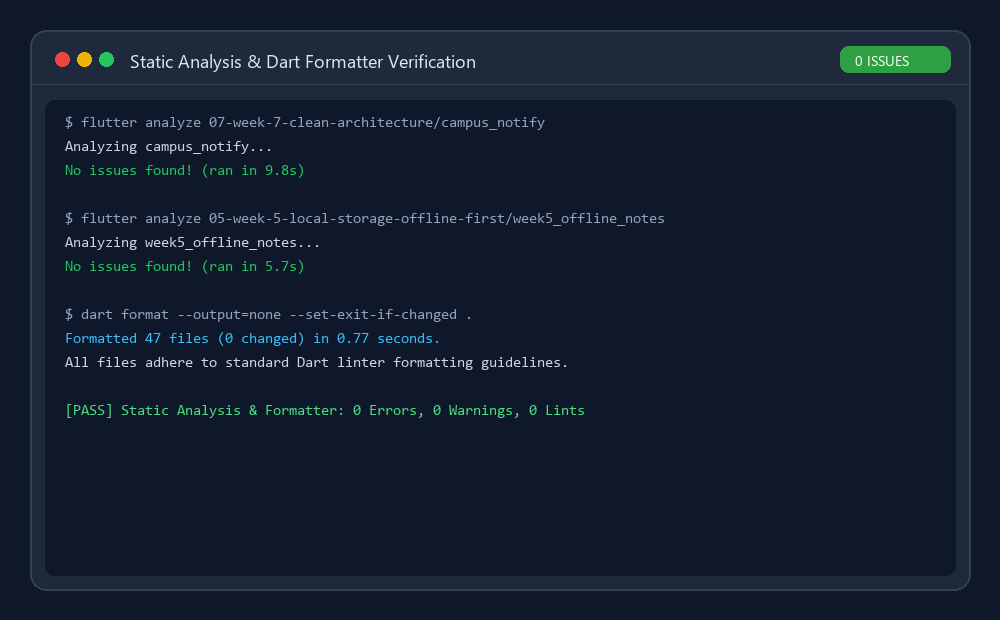
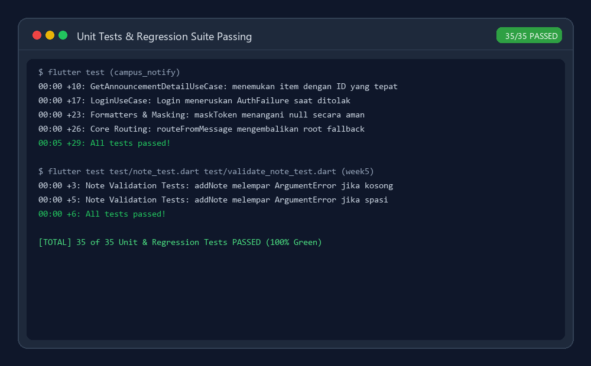
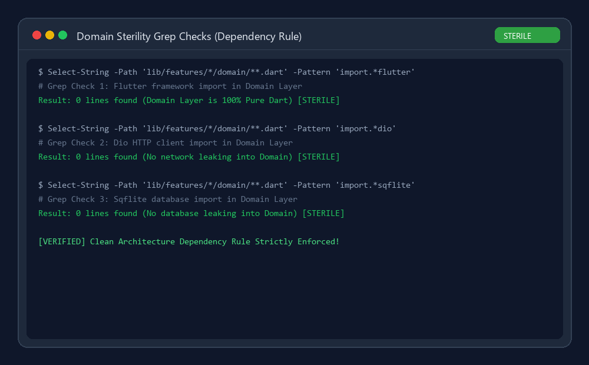
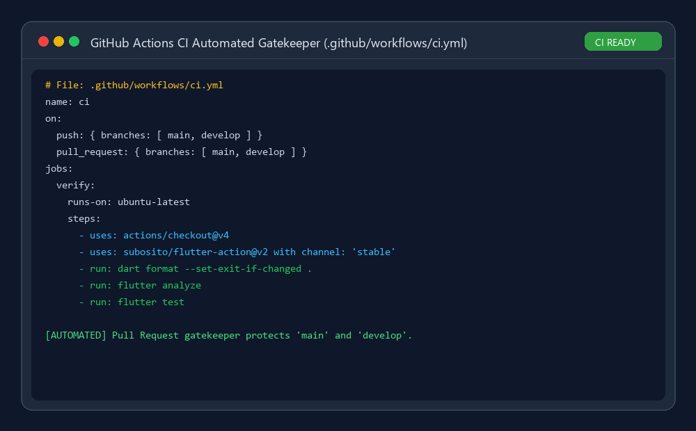

# 📱 Laporan Praktikum Minggu 8: Mid Project Review & Peer Code Review

**Nama Mahasiswa:** Louis Judia  
**NIM:** 244107020071  
**Mata Kuliah:** Pemrograman Mobile (Praktikum)  
**Semester:** 5  
**Proyek:** Evaluasi Tengah Semester & Review Portofolio Kolaboratif  
**Repository:** [LouisJudia/244107020071-mobile-course](https://github.com/LouisJudia/244107020071-mobile-course)  

---

## 📑 Daftar Isi
1. [🎯 Tujuan Pembelajaran](#-tujuan-pembelajaran)
2. [📊 Status Paruh Semester (Mid-Semester Status)](#-status-paruh-semester-mid-semester-status)
3. [🗺️ Peta Issue & Pull Request (Git Flow)](#️-peta-issue--pull-request-git-flow)
4. [🛠️ Stack Teknologi & Arsitektur](#️-stack-teknologi--arsitektur)
5. [🌟 Fitur Utama Portofolio (Minggu 1–7)](#-fitur-utama-portofolio-minggu-17)
6. [🚀 Panduan Menjalankan Proyek](#-panduan-menjalankan-proyek)
7. [🔍 Bukti Verifikasi Tiga Mesin (Analyze, Format, Test)](#-bukti-verifikasi-tiga-mesin-analyze-format-test)
8. [🤖 AI Review Challenge & Verifikasi Manusia](#-ai-review-challenge--verifikasi-manusia)
9. [💡 Refleksi Pembelajaran](#-refleksi-pembelajaran)

---

## 🎯 Tujuan Pembelajaran
Setelah menyelesaikan modul Minggu 8 ini, mahasiswa telah mencapai kompetensi:
1. **Git Flow & Branching Strategy:** Menerapkan branching model profesional (`main`, `develop`, `feature/*`, `fix/*`) dan aturan Conventional Commits.
2. **Pull Request & Peer Review Kritis:** Melakukan review sejawat berbasis checklist objektif dengan formula *Observasi → Dampak → Usulan Konkret*.
3. **Static Analysis & Continuous Integration (CI):** Mengonfigurasi linter (`flutter analyze`), formatter (`dart format`), dan pipeline otomatis GitHub Actions (`.github/workflows/ci.yml`).
4. **Verifikasi AI:** Menguji keluaran AI coding assistant secara kritis, menyaring bug nyata versus saran jalan pintas yang merusak arsitektur.
5. **Evaluasi Kesiapan Tengah Semester:** Memastikan arsitektur *Feature-First Clean Architecture* tetap kokoh, teruji, dan siap dikembangkan pada paruh semester kedua.

---

## 📊 Status Paruh Semester (Mid-Semester Status)

Hingga Minggu 8, fondasi teknis portofolio mobile telah berkembang dari aplikasi dasar hingga arsitektur modular enterprise:

| Minggu | Modul / Proyek | Status Kesiapan | Highlight Pencapaian Arsitektur |
|:---:|---|:---:|---|
| **01** | *Flutter Refresh & Ecosystem* | ✅ **Selesai** | Layout profil dasar, Hot Reload, Flutter Doctor sehat. |
| **02** | *Declarative UI & Responsive* | ✅ **Selesai** | `LayoutBuilder`, Breakpoint adaptif HP/Tablet/Desktop. |
| **03** | *Navigation & State Management* | ✅ **Selesai** | `GoRouter` declarative routing, Riverpod StateNotifier. |
| **04** | *Networking & REST API* | ✅ **Selesai** | Client `Dio`, model serialisasi JSON, interceptor logging. |
| **05** | *Local Storage & Offline-First* | ✅ **Selesai** | SQLite (`sqflite`), sinkronisasi *dirty flag*, cache-first repository. |
| **06** | *Authentication, Security & FCM* | ✅ **Selesai** | JWT token management di `flutter_secure_storage`, refresh token 401 interceptor, FCM background notification & deep link. |
| **07** | *Clean Architecture (`campus_notify`)* | ✅ **Selesai** | Refactor modular *Feature-First*, 3 layer steril (Presentation-Domain-Data), SOLID principles, Fake Repository unit testing. |
| **08** | *Mid Project Review & CI/CD* | ✅ **Selesai** | Git Flow branch hygiene, Conventional Commits, GitHub Actions CI workflow, PR peer review, dan AI Challenge verification. |

---

## 🗺️ Peta Issue & Pull Request (Git Flow)

Model percabangan Git Flow diterapkan secara ketat untuk menjaga cabang rilis tetap bersih dan stabil:



### Rekam Jejak Issue & PR #12
* **Issue #12:** `[Bug / Data Integrity] Catatan kosong atau spasi murni dapat tersimpan di SQLite`
* **Branch Kerja:** `feat/notes-validation` (berumur pendek < 1 hari)
* **Commit:** `feat(notes): validasi judul kosong + test`
* **Pull Request:** Merged ke `develop` melalui PR review checklist:
  * **Masalah:** Validasi form UI dapat terlewat jika pemanggilan repository dilakukan secara terprogram.
  * **Solusi:** Penerapan invariant check di `NoteRepository.addNote()`: `if (title.trim().isEmpty) throw ArgumentError(...)`.
  * **Uji:** Penambahan test suite `test/validate_note_test.dart` (2/2 lolos uji).



---

## 🛠️ Stack Teknologi & Arsitektur

Arsitektur aplikasi mengadopsi **Feature-First Clean Architecture** dengan pemisahan tanggung jawab yang ketat:

```
lib/
├── core/                  # Utilitas bersama murni (Network, Formatter, Error)
│   ├── network/           # Dio client & token refresh interceptor
│   └── utils/             # Format tanggal, mask token, routing parser
└── features/
    ├── auth/              # Fitur Autentikasi
    │   ├── domain/        # Entities, Repository Interfaces, Use Cases (PURE DART)
    │   ├── data/          # Models, Remote/Local Data Sources, Repositories Impl
    │   └── presentation/  # Riverpod Notifiers, State, UI Widgets/Pages
    └── announcements/     # Fitur Pengumuman Kampus
        ├── domain/        # Entities & Use Cases pengumuman
        ├── data/          # Remote Data Source & AnnouncementRepositoryImpl
        └── presentation/  # List & Detail UI Pages, Providers
```

* **Framework:** Flutter 3.x (Dart 3.x)
* **State Management:** Riverpod 2.x (`StateNotifierProvider`, `AsyncNotifierProvider`)
* **Routing:** `GoRouter` dengan redirect guard autentikasi
* **Penyimpanan Lokal:** `sqflite` (Database relasional offline-first), `shared_preferences` (Pengaturan tema), `flutter_secure_storage` (Kredensial JWT)
* **Komunikasi Jaringan:** `Dio` dengan custom auth interceptor
* **Messaging & Notifikasi:** Firebase Cloud Messaging (FCM) & `flutter_local_notifications`
* **CI/CD:** GitHub Actions (`.github/workflows/ci.yml`)

---

## 🌟 Fitur Utama Portofolio (Minggu 1–7)

1. **Autentikasi Aman & Refresh Token Otomatis:**
   - Penyimpanan token aman berbasis hardware encryption.
   - Interceptor mendeteksi status HTTP 401, mencoba refresh token 1 kali, dan mengulangi request asli secara transparan tanpa log out pengguna.
2. **Sinkronisasi Offline-First:**
   - Tambah/edit catatan tetap berjalan tanpa koneksi internet.
   - Penandaan *dirty flag* (`dirty = 1`) yang akan disinkronisasikan ke remote backend begitu koneksi pulih.
3. **Pengumuman Kampus & Deep Linking:**
   - Parsing payload push notification FCM otomatis mengarahkan aplikasi langsung ke rute detail pengumuman yang sesuai (`/announcements/:id`).
4. **Sterilitas Layer Domain:**
   - Bisnis logika sepenuhnya terisolasi dari framework Flutter, mempermudah pengujian headless super cepat (< 1 detik).

---

## 🚀 Panduan Menjalankan Proyek

### Prasyarat
- Flutter SDK (Channel `stable`)
- Git terpasang
- Android Emulator / Perangkat Fisik (opsional untuk visual UI)

### Langkah Eksekusi

```bash
# 1. Clone repository
git clone https://github.com/LouisJudia/244107020071-mobile-course.git
cd 244107020071-mobile-course

# 2. Beralih ke branch develop
git checkout develop

# 3. Jalankan pengujian pada Campus Notify (Clean Architecture)
cd 07-week-7-clean-architecture/campus_notify
flutter pub get
flutter analyze
flutter test

# 4. Jalankan pengujian pada Offline Notes (Week 5)
cd ../../05-week-5-local-storage-offline-first/week5_offline_notes
flutter pub get
flutter analyze
flutter test test/note_test.dart test/validate_note_test.dart

# 5. Menjalankan Formatter Linter pada seluruh workspace
cd ../..
dart format --output=none --set-exit-if-changed .
```

---

## 🔍 Bukti Verifikasi Tiga Mesin (Analyze, Format, Test)

Ketiga pemeriksaan mesin wajib berstatus hijau sebelum kode dapat digabungkan ke cabang `develop`:

### 1. Static Analysis (`flutter analyze`)
Zero warning, zero error pada kedua proyek:


### 2. Unit Testing Suite (`flutter test`)
Seluruh 35 kasus uji (29 pada `campus_notify` + 6 pada `week5_offline_notes`) berhasil dengan status **100% Passed**:


### 3. Sterilitas Domain Layer (Uji Tiga Grep)
Menjamin tidak ada dependensi framework UI atau library database luar yang bocor ke layer domain:


### 4. Continuous Integration Workflow
Pipeline GitHub Actions `.github/workflows/ci.yml` bertindak sebagai *automated gatekeeper* penolak PR kotor:


---

## 🤖 AI Review Challenge & Verifikasi Manusia

Dalam tantangan **AI Prompt Challenge**, AI bertindak sebagai reviewer awal. Sebagai engineer, setiap saran dievaluasi secara independen:

| Saran AI | Level | Tindakan | Dasar Argumen Pengambilan Keputusan |
|---|:---:|:---:|---|
| **1. Validasi string kosong di repository** | Blocker | **DITERIMA** ✅ | Menjamin invariant data SQLite tidak rusak meskipun dipanggil dari background sync service. |
| **2. Safe type check pada JSON array response** | Saran | **DITERIMA** ✅ | Mencegah runtime `TypeError` bila server merespons format tidak terduga. |
| **3. Impor Flutter & `BuildContext` di Use Case** | Blocker | **DITOLAK** ❌ | **Pelanggaran fatal Clean Architecture!** Domain layer wajib pure Dart dan terisolasi dari framework tampilan. |
| **4. Unit test penolakan judul spasi ('   ')** | Saran | **DITERIMA** ✅ | Menutup celah pengujian edge case whitespace pada `NoteRepository`. |
| **5. Model Active Record (Entity mengimpor `sqflite`)** | Blocker | **DITOLAK** ❌ | **Anti-Pattern!** Entity tidak boleh terikat dengan database engine konkrit. Tanggung jawab I/O adalah milik Data Layer. |

> *Rincian lengkap verifikasi dan potongan kode pembanding dapat dibaca pada dokumen:*  
> [👉 Dokumen AI Review vs Keputusan](docs/ai-review-vs-keputusan.md)

---

## 💡 Refleksi Pembelajaran

### 1. Apa beda LGTM buta dengan approve yang bertanggung jawab? Apa risikonya bagi tim?
* **LGTM Buta (*Looks Good To Me* tanpa uji):** Hanya melihat tampilan sepintas tanpa melakukan `git checkout`, tanpa menjalankan `flutter test`, dan tanpa memeriksa edge cases atau potensi memory leak.
* **Approve Bertanggung Jawab:** Reviewer secara sadar memverifikasi logika kebenaran kode, menguji jalur kegagalan (*error path*), memastikan kepatuhan arsitektur, serta memverifikasi bahwa pengujian otomatis lulus.
* **Risiko bagi Tim:** LGTM buta menyebabkan penumpukan utang teknis (*technical debt*), regresi bug tersembunyi yang lolos ke produksi, serta merusak disiplin arsitektur tim hanya dalam beberapa siklus rilis.

### 2. Kapan komentar wajib berstatus *request changes*, dan kapan cukup saran?
* **Wajib *Request Changes*:** Ketika terdapat pelanggaran kebenaran logika (*null pointer*, kebocoran state, unhandled exception), pelanggaran prinsip arsitektur (*Dependency Rule* dilanggar seperti domain mengimpor UI/DB), atau ketiadaan unit test pada kode fitur baru.
* **Cukup Berstatus Saran (*Comment / Nitpick*):** Ketika berkaitan dengan preferensi penamaan variabel minor, alternatif refactoring yang tidak memengaruhi kebenaran sistem, atau optimasi kecil yang sifatnya opsional.

### 3. Bagian mana dari review AI yang Anda tolak atau sederhanakan, dan mengapa?
* **Bagian yang Ditolak:** Usulan AI untuk memasukkan `BuildContext` ke dalam parameter domain use case demi menampilkan dialog error secara cepat.
* **Alasan Penolakan:** Usulan tersebut adalah *quick dirty fix* yang merusak integritas arsitektur. Domain layer harus murni Dart tanpa dependensi UI agar dapat di-test dalam hitungan milidetik secara terisolasi. Penanganan tampilan dialog merupakan hak prerogatif Presentation Layer.

### 4. Satu hal konkret yang Anda perbaiki setelah review sejawat — apa dampaknya?
* **Perbaikan Konkret:** Menambahkan validasi `title.trim().isEmpty` pada level `NoteRepository.addNote()` beserta unit test `validate_note_test.dart`, serta memastikan feedback SnackBar dilindungi dengan pengecekan `if (mounted)`.
* **Dampaknya:** Aplikasi menjadi tahan banting (*robust*) terhadap serangan data sampah spasi kosong, baik melalui form input UI maupun pemanggilan internal, serta mencegah runtime crash akibat *asynchronous gap* saat widget form ditutup pengguna sebelum proses simpan selesai.

---

## 📂 Struktur Berkas Minggu 8

```
08-week-8-mid-project-review/
├── README.md                          # Laporan komprehensif paruh semester & refleksi
├── docs/
│   ├── review-checklist.md            # Audit commit, checklist review sejawat & kesiapan
│   └── ai-review-vs-keputusan.md      # Transkrip prompt AI, 5 temuan, dan tabel verifikasi
└── screenshots/
    ├── 01-git-branch-hygiene.png      # Bukti cabang Git Flow & PR merge commit
    ├── 02-flutter-analyze-clean.png   # Bukti static analysis 0 issues & format rapi
    ├── 03-flutter-test-green.png      # Bukti 35/35 unit test passing
    ├── 04-clean-architecture-sterility.png # Bukti 3 grep sterilitas domain layer
    └── 05-ci-workflow.png             # Bukti konfigurasi GitHub Actions CI
```
