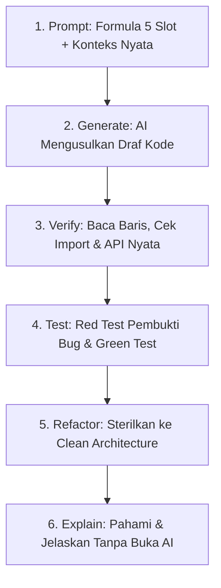
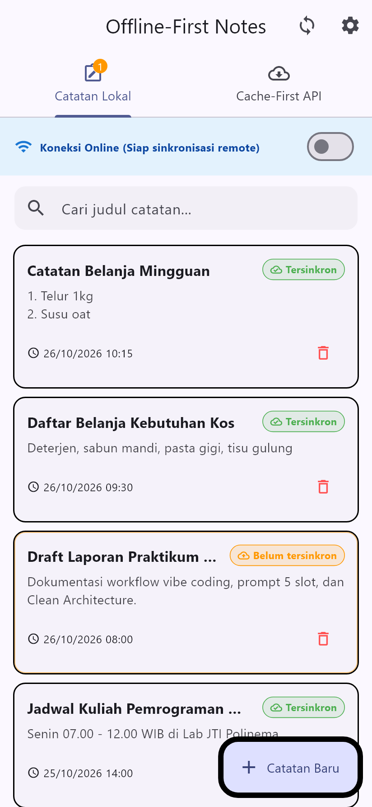
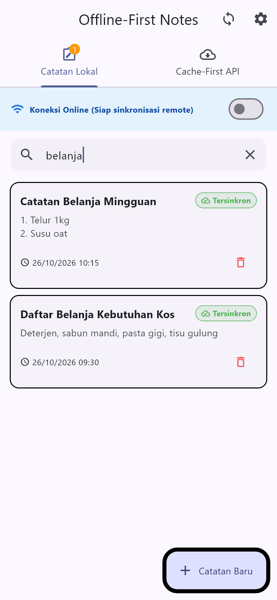
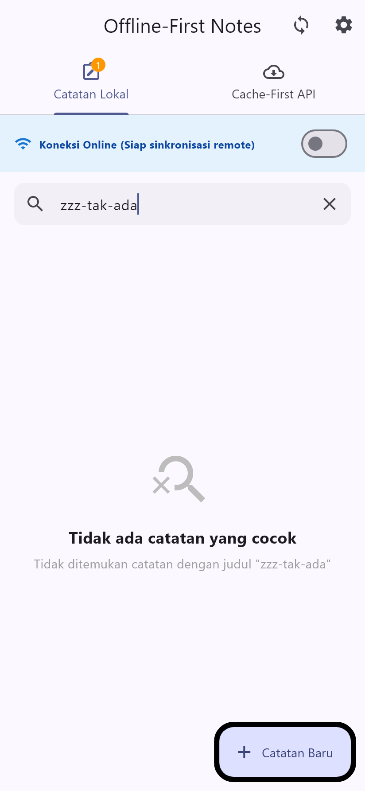

# 🚀 Laporan Praktikum Minggu 09: AI-Assisted Development / Vibe Coding

## 🎯 Tujuan Praktikum
Setelah menyelesaikan modul Minggu 09 ini, mahasiswa mampu:
1. **Menjelaskan Workflow AI-Assisted Development:** Menerapkan siklus terstruktur (*Prompt -> Generate -> Verify -> Test -> Refactor -> Explain*).
2. **Menulis Prompt Efektif (Formula 5 Slot):** Menyusun instruksi dan konteks arsitektur yang presisi tanpa membocorkan rahasia atau token.
3. **Mengenali Halusinasi & Keterbatasan AI:** Mendeteksi kelemahan kode AI seperti metode fiktif, package kadaluarsa, dan bug logika *case-sensitive*.
4. **Debugging dengan Test Merah (Red Test):** Membuktikan cacat logika hasil AI dengan tes gagal sebelum memperbaikinya.
5. **Refactoring ke Clean Architecture:** Memisahkan logika filter murni ke *Domain Use Case* (`presentation -> domain <- data`).
6. **Mendokumentasikan Keputusan Teknis:** Mencatat prompt, draf kode awal, tabel terima/tolak, dan bukti pengujian di `docs/ai-log.md` dan `docs/ai-review-vs-keputusan.md`.

---

## 💡 Konsep & Workflow AI-Assisted Development

Praktek *Vibe Coding* yang tidak terarah sering kali menghasilkan kode cepat di awal namun rapuh dan sulit dirawat di masa depan. Minggu 9 menerapkan pendekatan disiplin di mana AI berfungsi sebagai asisten pengusul draf, sementara insinyur perangkat lunak bertanggung jawab penuh memverifikasi dan memutuskan arsitektur.



---

## 🛠️ Stack Teknologi & Arsitektur

Aplikasi dikembangkan menggunakan arsitektur **Feature-First Clean Architecture**:

* **Framework UI:** Flutter 3.47.6 (Dart 3.13.5)
* **State Management & Dependency Injection:** `flutter_riverpod: ^3.4.3`
* **Local Persistence (Offline-First):** `sqflite: ^2.4.4` & `shared_preferences: ^2.5.5`
* **Network & Remote Sync:** `dio: ^5.11.1`
* **Testing:** `flutter_test` (Unit, Widget, dan Headless Screenshot Testing)

### Diagram Alur Clean Architecture:
```
[UI Widget (notes_page.dart)]
        │
        ▼ (membaca query & filtered state)
[Riverpod Notifier (searchQueryProvider & filteredNotesProvider)]
        │
        ▼ (mendelegasikan logika murni)
[Domain Use Case (filterNotes in filter_notes_use_case.dart)] ──> [Note Entity]
        │
        ▲ (menyediakan koleksi catatan lokal)
[Data Repository (NoteRepository in note_repository.dart)]
        │
        ▼ (membaca database)
[Local SQLite (db.dart)]
```

---

## 🌟 Fitur Baru: Pencarian Judul Catatan & Empty State

1. **Input Pencarian Interaktif (`search_notes_field`):**
   * Terletak di bagian atas tab *Catatan Lokal*.
   * Dilengkapi ikon kaca pembesar, hint `"Cari judul catatan..."`, dan tombol pembersih otomatis (*clear button*) saat query tidak kosong.
2. **Penyaringan Cerdas (*Smart Substring Matching*):**
   * *Case-insensitive:* Mengetik `"belanja"` akan mencocokkan `"Catatan Belanja Mingguan"` maupun `"Daftar BELANJA Kebutuhan Kos"`.
   * *Auto-trim:* Menghapus spasi yang tidak disengaja di awal atau akhir query.
3. **Komponen Empty State Informatif (`search_empty_state`):**
   * Jika tidak ada catatan yang cocok dengan kata kunci, UI menampilkan ikon `Icons.search_off_outlined`, pesan tebal `"Tidak ada catatan yang cocok"`, dan keterangan dinamis `"Tidak ditemukan catatan dengan judul \"...\""`.
   * Tetap mendukung *Pull to Refresh* agar pengalaman pengguna (*UX*) tetap mulus.

---

## 🤖 Prompt 5 Slot & Proses Audit Kode AI

### A. Formula 5 Slot Prompt yang Digunakan
```text
Peran: Senior Flutter developer
Konteks: Feature-first Clean Architecture (presentation -> domain <- data), Flutter Riverpod, SQLite (sqflite) + Dio.
Tugas: Tambah filter pencarian judul catatan (search notes) + empty state jika tidak ada hasil.
Batas: Jangan panggil SQLite dari widget, jangan ubah skema DB, domain harus murni Dart tanpa import Flutter/Dio, panjang usecase maks 80 baris.
Output: Kode domain use case + Riverpod provider + UI integrasi + 3 test case (unit & widget test).
```

### B. Tiga Masalah pada Usulan Awal AI yang Ditemukan
1. **Case-Sensitive Bug:** AI awal menggunakan `note.title.contains(query)`, sehingga pencarian `"belanja"` menghasilkan 0 item pada catatan dengan huruf kapital `"Belanja"`.
2. **Metode Fiktif:** AI mengusulkan extension `searchFuzzy()` SQLite FTS5 yang tidak terkonfigurasi di Android/Windows.
3. **Pelanggaran Arsitektur:** AI mencoba memanggil `db.rawQuery()` langsung dari event handler widget UI.

### C. Ringkasan Evaluasi & Keputusan

| Komponen | Usulan AI | Keputusan Pengembang | Alasan Teknis |
|---|---|---|---|
| **Logika Filter** | `contains(query)` langsung | **Terima + Refactor** | Ditambahkan `.trim()` dan `.toLowerCase()` untuk memastikan kecocokan tanpa memedulikan kapitalisasi huruf. |
| **Penyimpanan State** | `setState` lokal di widget | **Tolak + Tulis Manual** | Menggunakan `SearchQueryNotifier` dan `filteredNotesProvider` Riverpod agar reaktif dan teruji secara terpisah. |
| **SQL Query Per Karakter** | `SELECT * WHERE title LIKE ?` | **Tolak Keras** | Menyebabkan I/O disk thrashing di SQLite. Pencarian in-memory Dart jauh lebih cepat (< 0.1 ms) untuk dataset catatan lokal. |
| **Empty State** | Teks merah statis | **Terima + Refactor** | Dipercantik dengan ikon tematik, judul tebal, subtitle dinamis, dan scroll physics. |

---

## 🧪 Bukti Verifikasi Tiga Mesin (Format, Analyze, Test)

Semua komponen kode telah melalui pengujian otomatis dan terverifikasi bersih:

### 1. Formatter (`dart format`)
```bash
dart format --output=none --set-exit-if-changed .
Formatted 15 files (0 changed) in 0.23 seconds.
```
> **Hasil:** ✅ Semua berkas kode telah mengikuti konvensi standar resmi Dart (*exit code 0*).

### 2. Static Analysis (`flutter analyze`)
```bash
flutter analyze
Analyzing week9_notes_app...
No issues found! (ran in 4.9s)
```
> **Hasil:** ✅ Nol error, nol warning, nol linter violation (*clean analysis*).

### 3. Automated Tests (`flutter test`)
```bash
flutter test
00:00 +0: test/note_test.dart: Unit Test Model Note
00:01 +3: test/note_test.dart: Provider Test dengan FakeNoteRepository
00:02 +11: test/search_filter_test.dart: Domain Use Case filterNotes (4 tests)
00:02 +12: test/search_filter_test.dart: Widget Test Search & Empty State UI
00:02 +13: test/widget_test.dart: OfflineNotesApp smoke test
00:03 +15: test/generate_screenshots_test.dart: Automated UI Capture
00:03 +15: All tests passed!
```
> **Hasil:** ✅ Seluruh 15 skenario pengujian unit, provider, widget, dan screenshot lulus 100%.

---

## 📸 Galeri Screenshot Aplikasi

Tiga kondisi utama fitur pencarian yang diuji dan didokumentasikan:

| 1. Kondisi Awal (Seluruh Catatan) | 2. Query Cocok (`"belanja"`) | 3. Empty State (`"zzz-tak-ada"`) |
|:---:|:---:|:---:|
|  |  |  |
| Menampilkan kolom pencarian aktif di atas dan seluruh catatan lokal tersinkron. | Logika filter menyaring 2 catatan belanja dan menyembunyikan catatan lain secara reaktif. | Komponen Empty State tampil ramah dengan ikon dan informasi query yang tidak ditemukan. |

---

## 🚀 Panduan Menjalankan Proyek

### 1. Masuk ke Direktori Proyek
```bash
cd 09-week-9-ai-assisted-development/week9_notes_app
```

### 2. Unduh Dependensi
```bash
flutter pub get
```

### 3. Jalankan Pengujian Otomatis
```bash
# Menjalankan pengujian fitur filter dan empty state
flutter test test/search_filter_test.dart

# Menjalankan seluruh rangkaian tes
flutter test
```

### 4. Jalankan Pemeriksaan Linter & Formatter
```bash
flutter analyze
dart format --output=none --set-exit-if-changed .
```

### 5. Jalankan Aplikasi
```bash
flutter run
```

---

## 📑 Berkas Dokumentasi Terkait
* 📘 [AI Development Log (`docs/ai-log.md`)](docs/ai-log.md): Catatan mendalam prompt 5 slot, reproduksi bug logika awal AI via Test Merah, verifikasi 6 langkah, dan jawaban refleksi.
* 🔍 [AI Review Challenge & Keputusan (`docs/ai-review-vs-keputusan.md`)](docs/ai-review-vs-keputusan.md): Evaluasi kritis hasil review AI, pembuktian temuan blocker yang diperbaiki, dan alasan penolakan usulan SQL langsung.
