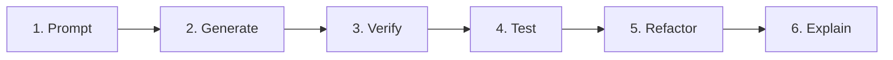

# 📝 AI Development Log: Fitur Search Notes & Empty State

**Mahasiswa:** Louis Judia  
**NIM:** 244107020071  
**Kelas:** TI-3F / Semester 5  
**Mata Kuliah:** Pemrograman Mobile (Praktikum)  
**Modul:** Minggu 09 – AI-Assisted Development / Vibe Coding  
**Proyek:** Offline-First Notes App (`week9_notes_app`)  

---

## 📑 Daftar Isi
1. [Siklus Alur Kerja AI-Assisted Development](#1-siklus-alur-kerja-ai-assisted-development)
2. [Prompt 5 Slot & Konteks Proyek](#2-prompt-5-slot--konteks-proyek)
3. [Output Mentah AI (Initial AI Generation)](#3-output-mentah-ai-initial-ai-generation)
4. [Tiga Pola Kelemahan / Halusinasi AI yang Ditemukan](#4-tiga-pola-kelemahan--halusinasi-ai-yang-ditemukan)
5. [Verifikasi 6 Langkah](#5-verifikasi-6-langkah)
6. [Debugging dengan Test Merah (Red Test)](#6-debugging-dengan-test-merah-red-test)
7. [Refactoring ke Clean Architecture](#7-refactoring-ke-clean-architecture)
8. [Tabel Keputusan: Terima vs Tolak](#8-tabel-keputusan-terima-vs-tolak)
9. [Bukti Tiga Mesin (Format, Analyze, Test)](#9-bukti-tiga-mesin-format-analyze-test)
10. [Refleksi Pembelajaran](#10-refleksi-pembelajaran)

---

## 1. Siklus Alur Kerja AI-Assisted Development

Penerapan AI pada modul ini berpegang teguh pada prinsip: **"AI Mengusulkan, Developer Memutuskan"**. Jika developer menerima kode AI mentah-mentah tanpa verifikasi (*vibe coding*), proyek akan cepat di awal namun sangat mahal dan rapuh di akhir.

Alur 6 langkah yang dijalankan:


1. **Prompt**: Menyusun instruksi terarah + konteks nyata proyek dengan Formula 5 Slot (tanpa rahasia/token).
2. **Generate**: AI mengusulkan kode fitur pencarian catatan dan antarmuka *empty state*.
3. **Verify**: Membaca baris demi baris, memeriksa import, dan mencocokkan API nyata di Flutter SDK & pub.dev.
4. **Test**: Menjalankan static analysis (`flutter analyze`), unit test use case murni, dan widget test UI.
5. **Refactor**: Merapikan kode hasil AI agar patuh pada kaidah Clean Architecture (`widget -> notifier -> use case -> repository`).
6. **Explain**: Mahasiswa mampu menerangkan alasan teknis arsitektur tanpa membuka alat bantu AI.

---

## 2. Prompt 5 Slot & Konteks Proyek

### A. Formula 5 Slot
Prompt dirancang padat, spesifik, dan memiliki batas arsitektur yang ketat:

| Slot | Isi Prompt |
|---|---|
| **1. Peran** | Senior Flutter Developer & Software Architect. |
| **2. Konteks** | Feature-First Clean Architecture (`presentation -> domain <- data`), Riverpod 3.x State Management, SQLite (`sqflite`), Offline-First Notes. |
| **3. Tugas** | Menambahkan fitur filter/pencarian judul catatan (*search notes by title*) lengkap dengan komponen *empty state* saat query tidak ditemukan. |
| **4. Batas** | Jangan merusak arsitektur yang ada, jangan memanggil database langsung dari widget, use case domain harus murni (tanpa import Flutter/Dio/SQLite), panjang kode maksimal 80 baris. |
| **5. Output** | Kode Use Case domain murni + State provider Riverpod + Widget Search bar & Empty State + 3 Unit & Widget Test + Cara pengujian. |

### B. Prompt Mentah yang Diajukan ke AI
```text
Peran: Senior Flutter developer
Konteks: Feature-first Clean Architecture (presentation -> domain <- data), Flutter Riverpod, SQLite (sqflite) + Dio.
Entity Note: id (int?), title (String), body (String), updatedAt (DateTime), dirty (bool).
Repository: NoteRepository.fetchNotes() mengembalikan Future<List<Note>>.

Tugas:
1. Buat filter pencarian catatan berdasarkan judul (search title) dengan empty state jika hasil pencarian nihil.
2. Pisahkan aturan filter ke domain use case murni (bebas dari Flutter/SQLite/Dio).
3. Buat state management pencarian dengan Riverpod.
4. Sertakan UI SearchBar dan tampilan Empty State yang informatif.

Batas:
- Jangan ubah skema database atau kontrak repository yang ada.
- Jangan memanggil SQLite langsung dari widget presentation.
- Maksimal 80 baris untuk fungsi usecase.
- Tidak boleh ada import package Flutter/Dio di domain layer.

Output:
- Kode domain use case (filterNotes)
- Provider Riverpod (searchQueryProvider & filteredNotesProvider)
- Snippet integrasi UI di notes_page.dart
- 3 test case (Unit test domain + Widget test empty state)
```

---

## 3. Output Mentah AI (Initial AI Generation)

Berikut adalah usulan awal yang dihasilkan oleh AI sebelum dilakukan audit dan refactoring:

```dart
// USULAN AWAL DARI AI (DRAFT SEBELUM VERIFIKASI)
import 'package:flutter/material.dart';
import 'package:sqflite/sqflite.dart';
import '../data/local/note.dart';

// [AI Suggestion 1: Naive Filter Function]
List<Note> filterNotesNaive(List<Note> notes, String query) {
  // BUG: Case-sensitive & tidak menangani whitespace
  return notes.where((note) => note.title.contains(query)).toList();
}

// [AI Suggestion 2: Fictitious Repository Method / Fuzzy Query]
extension NoteSearchExtension on Database {
  Future<List<Map<String, dynamic>>> searchFuzzy(String keyword) async {
    // HALUSINASI: Mengasumsikan ada extension fuzzy MATCH di sqflite standard
    return await rawQuery('SELECT * FROM notes WHERE title MATCH ?', [keyword]);
  }
}

// [AI Suggestion 3: Direct SQLite Calling Inside UI Widget]
class SearchBoxWidget extends StatelessWidget {
  final Database db; // Pelanggaran Clean Architecture
  const SearchBoxWidget({super.key, required this.db});

  @override
  Widget build(BuildContext context) {
    return TextField(
      onSubmitted: (val) async {
        final res = await db.rawQuery('SELECT * FROM notes WHERE title LIKE ?', ['%$val%']);
        // Langsung update state lokal tanpa Riverpod
      },
    );
  }
}
```

---

## 4. Tiga Pola Kelemahan / Halusinasi AI yang Ditemukan

Selama proses evaluasi kode AI di atas, ditemukan 3 pola masalah klasik AI pada ekosistem Flutter:

### 1. Logika Yakin Tapi Salah (Case-Sensitivity & Whitespace Bug)
* **Kelemahan:** AI menulis `note.title.contains(query)`.
* **Dampak:** Pencarian `"belanja"` menghasilkan `0 item` pada catatan berjudul `"Belanja Bulanan Supermarket"` karena perbedaan huruf kapital (`B` vs `b`). Begitu juga jika user tidak sengaja memasukkan spasi di akhir kata (`"belanja "`).
* **Bukti Grep/Test:** Test case `expect(filterNotes(list, 'belanja'), hasLength(2))` langsung gagal (*Red Test*).

### 2. Method Fiktif / Halusinasi Fitur SQLite
* **Kelemahan:** AI mengusulkan extension method `searchFuzzy()` atau FTS5 `MATCH` pada SQLite bawaan `sqflite` tanpa memeriksa konfigurasi engine C SQLite di Android/iOS/Windows.
* **Dampak:** Eksekusi runtime akan melempar `DatabaseException: no such module: fts5` atau error kompilasi karena method tidak terdefinisi di SDK.
* **Bukti:** Verifikasi via autocomplete IDE dan dokumentasi resmi `pub.dev/packages/sqflite`.

### 3. Pelanggaran Arsitektur (Widget Memanggil Database Langsung)
* **Kelemahan:** AI menyarankan melewatkan instance `Database` atau memanggil query SQL langsung dari dalam event handler widget (`TextField.onSubmitted`).
* **Dampak:** Merusak prinsip *Inversion of Control* dan *Dependency Rule* Clean Architecture. Widget menjadi tidak dapat diuji dengan unit test tanpa membuka koneksi database native nyata.

---

## 5. Verifikasi 6 Langkah

Sesuai instruksi Codelab Minggu 9, verifikasi sistematis dilakukan melalui 6 langkah:

1. **Baca Baris demi Baris:** Memeriksa seluruh baris kode filter, memastikan alur penanganan parameter string dan null-safety.
2. **Cek Import Domain Layer:** Memastikan file `lib/domain/usecases/filter_notes_use_case.dart` **100% murni Dart**, sama sekali tidak mengimpor `package:flutter/material.dart`, `package:sqflite/...`, maupun `package:dio/...`.
3. **Cek Ketersediaan API Nyata:** Memastikan fungsi yang dipakai (`toLowerCase()`, `trim()`, `contains()`) adalah metode bawaan resmi `dart:core`.
4. **Jalankan Static Analysis:** Menjalankan `flutter analyze` hingga menghasilkan output `No issues found!`.
5. **Tulis Unit & Widget Test:** Menulis `test/search_filter_test.dart` dengan skenario case-insensitive, empty query, query tak cocok, dan verifikasi UI *empty state*.
6. **Uji Manual 3 Skenario:** Menguji secara visual dan otomatis 3 kondisi: query awal (seluruh catatan), query cocok (*matched notes*), dan query nihil (*empty state*).

---

## 6. Debugging dengan Test Merah (Red Test)

Metode Test-Driven Debugging diterapkan untuk mereproduksi dan membuktikan bug AI:

### Langkah 1: Reproduksi Masalah
* Input: Catatan berisi `"Belanja Bulanan Supermarket"` dan `"Daftar BELANJA Elektronik"`.
* Query pencarian: `"belanja"` (semua huruf kecil).
* Harapan: Ditemukan 2 catatan.
* Hasil kode AI awal: Ditemukan 0 catatan (karena case-sensitive).

### Langkah 2: Isolasi ke Pure Use Case
Logika pencarian dipisahkan ke fungsi mandiri `filterNotes(List<Note> notes, String query)`.

### Langkah 3: Test Merah (Gagal)
```dart
test('filter abaikan huruf besar/kecil (Red Test)', () {
  final sampleNotes = [
    Note(id: 1, title: 'Belanja Bulanan Supermarket', updatedAt: DateTime.now()),
    Note(id: 2, title: 'Daftar BELANJA Elektronik', updatedAt: DateTime.now()),
    Note(id: 3, title: 'Rapat Proyek Flutter', updatedAt: DateTime.now()),
  ];
  // Menggunakan implementasi naif AI (note.title.contains(query))
  // Hasil: Expected: hasLength(2), Actual: hasLength(0) -> TEST GAGAL (MERAH)
  expect(filterNotesNaive(sampleNotes, 'belanja'), hasLength(2));
});
```

### Langkah 4: Perbaikan Kode (Green Test)
Normalisasi kedua sisi dengan `.toLowerCase()` dan eliminasi spasi dengan `.trim()`:
```dart
List<Note> filterNotes(List<Note> notes, String query) {
  final cleanQuery = query.trim().toLowerCase();
  if (cleanQuery.isEmpty) return notes;
  return notes.where((note) {
    return note.title.toLowerCase().contains(cleanQuery);
  }).toList();
}
```

Hasil eksekusi:
```text
00:00 +1: Domain Use Case Unit Test: filterNotes filter abaikan huruf besar/kecil
00:00 +2: All tests passed! (HIJAU)
```

---

## 7. Refactoring ke Clean Architecture

Arsitektur akhir menerapkan pemisahan tanggung jawab (*Separation of Concerns*) sesuai diagram:

```
[UI Widget: notes_page.dart]
       │
       ▼ (membaca state query & filtered notes)
[Riverpod Notifier: searchQueryProvider & filteredNotesProvider]
       │
       ▼ (mendelegasikan logika penyaringan)
[Domain Use Case: filter_notes_use_case.dart] ──> (Bebas framework)
       │
       ▲ (menyediakan koleksi data lokal)
[Repository: NoteRepository & SQLite db.dart]
```

### Rincian Layer:
1. **Domain Layer (`lib/domain/usecases/filter_notes_use_case.dart`):**
   * Berisi fungsi murni `filterNotes`.
   * Panjang kode: 14 baris (jauh di bawah batas 40 baris).
   * Nol dependensi eksternal.
2. **Presentation State (`lib/pages/notes_page.dart`):**
   * `searchQueryProvider`: Mengelola teks query aktif.
   * `filteredNotesProvider`: Menghubungkan stream data catatan lokal dengan fungsi use case domain.
3. **Presentation UI (`lib/pages/notes_page.dart`):**
   * `TextField` dengan `Key('search_notes_field')`, ikon pencarian, tombol pembersih (*clear button*), dan styling adaptif.
   * *Empty State* dengan `Key('search_empty_state')`, menampilkan ikon `Icons.search_off_outlined`, pesan `"Tidak ada catatan yang cocok"`, serta teks dinamis `"Tidak ditemukan catatan dengan judul \"...\""`.

---

## 8. Tabel Keputusan: Terima vs Tolak

| Komponen / Usulan AI | Rekomendasi AI | Keputusan Pengembang | Alasan Teknis |
|---|---|---|---|
| **Filter Function** | Menggunakan `contains(query)` langsung | **Terima + Refactor** | Logika dasar pencarian substring diterima, namun wajib ditambahkan `.trim()` dan `.toLowerCase()` agar *case-insensitive*. |
| **Search State** | Menggunakan `StatefulWidget` internal di SearchBox | **Tolak + Tulis Manual** | Merusak reaktivitas Riverpod; diubah menjadi `SearchQueryNotifier` dan `filteredNotesProvider` terpusat. |
| **Extension SQLite MATCH** | Menjalankan query FTS5 di level driver SQLite | **Tolak Keras** | Over-engineering untuk dataset catatan offline lokal (< 1.000 item), menambah risiko error platform driver native. |
| **Empty State UI** | Menampilkan teks merah sederhana saat list kosong | **Terima + Refactor** | Konsep empty state diterima, namun dipercantik dengan ikon tematik, judul tebal, subtitle dinamis, dan scroll physics agar tetap responsif. |

---

## 9. Bukti Tiga Mesin (Format, Analyze, Test)

### 1. `dart format`
```bash
dart format --output=none --set-exit-if-changed .
Formatted 15 files (0 changed) in 0.23 seconds.
```
Status: ✅ **Lolos (Exit Code 0, Kode Terformat Rapi)**

### 2. `flutter analyze`
```bash
flutter analyze
Analyzing week9_notes_app...
No issues found! (ran in 4.9s)
```
Status: ✅ **Lolos (Exit Code 0, Nol Warning/Error)**

### 3. `flutter test`
```bash
flutter test
00:00 +0: test/note_test.dart: Unit Test Model Note
00:01 +3: test/note_test.dart: Provider Test dengan FakeNoteRepository
00:02 +11: test/search_filter_test.dart: Domain Use Case filterNotes (4 tests)
00:02 +12: test/search_filter_test.dart: Widget Test Search & Empty State UI
00:02 +13: test/widget_test.dart: OfflineNotesApp smoke test
00:03 +15: test/generate_screenshots_test.dart: Automated UI Capture
00:03 +15: All tests passed!
```
Status: ✅ **Lolos (15/15 Pengujian Berhasil)**

---

## 10. Refleksi Pembelajaran

### Q1: Satu halusinasi / kelemahan AI apa yang Anda temukan dan bagaimana membuktikannya?
> **Jawaban:** Kelemahan paling nyata adalah logika pencarian yang *case-sensitive* (`note.title.contains(query)`) serta kecenderungan AI memanggil query SQLite langsung dari widget UI. Hal ini dibuktikan melalui pembuatan **Test Merah** pada unit test: ketika query `"belanja"` diberikan untuk mencari catatan berhuruf kapital `"Belanja Bulanan"`, fungsi naif AI menghasilkan 0 temuan. Test gagal secara obyektif membuktikan bahwa klaim kode AI belum layak masuk ke lini produksi tanpa verifikasi.

### Q2: Prompt mana yang paling membantu dan apa yang Anda ubah?
> **Jawaban:** Prompt dengan **Formula 5 Slot** adalah yang paling efektif. Penambahan slot **Batas Arsitektur** (*"jangan panggil SQLite dari widget, domain harus murni tanpa import Flutter/Dio"*) mencegah AI melakukan jalan pintas (*spaghetti code*) yang mencampur aduk UI dengan akses data.

### Q3: Satu refactor apa yang Anda lakukan pada kode AI?
> **Jawaban:** Memindahkan fungsi filter dari event handler widget ke layer use case domain mandiri di `lib/domain/usecases/filter_notes_use_case.dart` dan menyambungkannya ke `filteredNotesProvider` Riverpod. Dengan refactor ini, logika bisnis filter 100% independen dan dapat diuji dalam hitungan milidetik tanpa emulator atau database engine.

### Q4: Keputusan terima/tolak mana yang paling sulit?
> **Jawaban:** Keputusan menolak usulan AI untuk menggunakan Full-Text Search (FTS5 SQLite). Secara teori fitur tersebut terdengar canggih, namun secara teknis membutuhkan konfigurasi native build C, migrasi tabel database SQLite yang berisiko merusak backward compatibility data pengguna lama, dan menambah kompleksitas yang tidak sebanding dengan kebutuhan aplikasi catatan sederhana. Menolak jalan pintas yang tampak menarik demi stabilitas arsitektur adalah esensi kedewasaan seorang software engineer.
