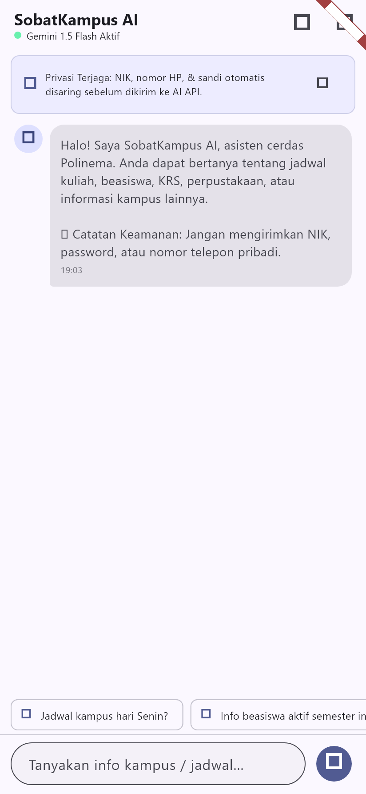
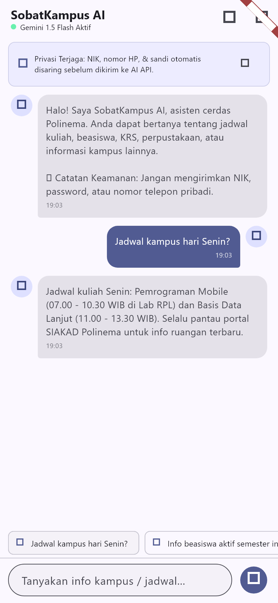
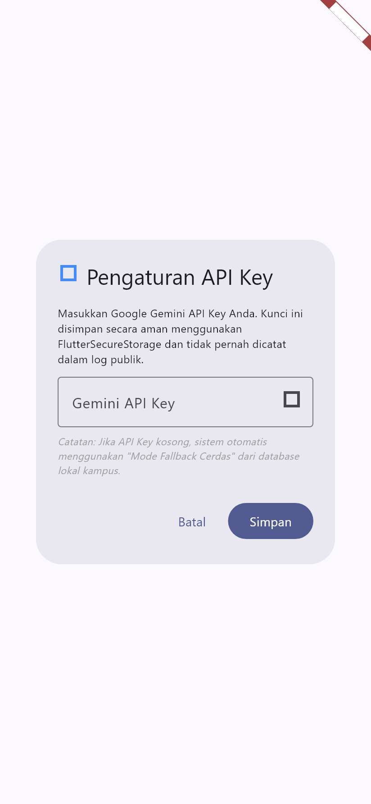
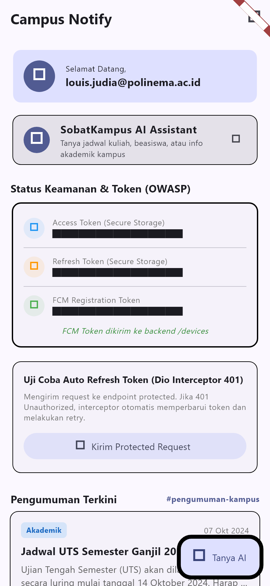

# 🚀 Laporan Praktikum Minggu 10: AI Feature Integration (Integrasi Fitur AI)

**Mahasiswa:** Louis Judia  
**NIM:** 244107020071  
**Kelas:** TI-3F / Semester 5  
**Mata Kuliah:** Pemrograman Mobile (Praktikum)  
**Jurusan / Prodi:** Jurusan Teknologi Informasi / D4 Teknik Informatika  
**Institusi:** Politeknik Negeri Malang  
**Repository:** [LouisJudia/244107020071-mobile-course](https://github.com/LouisJudia/244107020071-mobile-course)  

---

## 📑 Daftar Isi
1. [🎯 Tujuan Praktikum](#-tujuan-praktikum)
2. [💡 Konsep & Arsitektur Integrasi Fitur AI](#-konsep--arsitektur-integrasi-fitur-ai)
3. [🌟 Fitur yang Diintegrasikan: SobatKampus AI Assistant](#-fitur-yang-diintegrasikan-sobatkampus-ai-assistant)
4. [🛡️ Tabel Risiko & Mitigasi (Privasi, Biaya, Error, dan Fallback)](#️-tabel-risiko--mitigasi-privasi-biaya-error-dan-fallback)
5. [🤖 Prompt Design untuk Mobile](#-prompt-design-untuk-mobile)
6. [🧪 Bukti Verifikasi Tiga Mesin (Format, Analyze, Test)](#-bukti-verifikasi-tiga-mesin-format-analyze-test)
7. [📸 Galeri Screenshot Aplikasi](#-galeri-screenshot-aplikasi)
8. [💭 Refleksi Praktikum](#-refleksi-praktikum)
9. [🚀 Panduan Menjalankan Proyek](#-panduan-menjalankan-proyek)

---

## 🎯 Tujuan Praktikum
Setelah menyelesaikan modul Minggu 10 ini, mahasiswa mampu:
1. Memahami konsep integrasi LLM API (Google Gemini 1.5 Flash) ke dalam aplikasi mobile Flutter.
2. Merancang *Chat Interface* modern dengan *streaming response*, indikator pengetikan (*typing indicator*), dan penanganan status jaringan.
3. Menerapkan *Prompt Design* yang aman, ringkas, dan efektif untuk perangkat mobile.
4. Menangani aspek krusial: **Privasi (data sanitization)**, **Biaya (rate limiting)**, **Error Handling**, dan **Fallback Design (graceful degradation)**.
5. Mematuhi kaidah arsitektur bersih (*Clean Architecture*) dan prinsip **"AI Mengusulkan, Developer Memutuskan"**.

---

## 💡 Konsep & Arsitektur Integrasi Fitur AI

Integrasi model AI ke dalam aplikasi `Campus Notify` mengikuti bagan arsitektur modular berikut:

```
+--------------------------------------------------------------+
|                         Flutter UI                           |
|  (ChatScreen, QuickChips, ChatBubble, TypingIndicator)       |
+--------------------------------------------------------------+
                               |
                               v
+--------------------------------------------------------------+
|                   Presentation State Layer                   |
|              (ChatNotifier via Riverpod 3.x)                 |
+--------------------------------------------------------------+
                               |
                               v
+--------------------------------------------------------------+
|                      Domain Layer                            |
|  (SendPromptUseCase: Regex Sanitizer, Daily Rate Limiter)     |
+--------------------------------------------------------------+
            |                                      |
            v                                      v
+-----------------------+              +-----------------------+
|  Remote AI Data Layer |              |  Local Fallback Engine|
|  (AiService: Gemini)  |              |  (Offline Knowledge)  |
+-----------------------+              +-----------------------+
            |
            | API Key (Encrypted Hardware Keystore)
            v
+-----------------------+
| FlutterSecureStorage  |
+-----------------------+
```

### Prinsip Utama Integrasi:
- **Kunci API Terisolasi:** Kunci Gemini API tidak pernah di-hardcode ke repositori; disimpan terenkripsi di `FlutterSecureStorage` (Android Keystore / iOS Keychain).
- **Zero Sensitive Data:** Data identitas (NIK, nomor HP) disaring di sisi klien sebelum menjangkau jaringan internet.
- **Graceful Fallback:** Jika jaringan putus atau kuota habis, aplikasi tidak crash, melainkan menyajikan informasi akademik lokal yang relevan.

---

## 🌟 Fitur yang Diintegrasikan: SobatKampus AI Assistant

1. **Live Interactive Chat Assistant:**
   - Mahasiswa dapat menanyakan jadwal perkuliahan, info beasiswa, prosedur KRS, dan lokasi layanan kampus secara langsung.
2. **Progressive Response Streaming:**
   - Respon AI di-stream per kata (*chunk-by-chunk*) untuk memberikan UX mobile yang responsif dan tidak monoton.
3. **Typing & Loading Indicator:**
   - Indikator pengetikan halus yang memberi umpan balik visual saat server sedang memproses jawaban.
4. **Quick Suggestion Chips:**
   - Tombol kueri cepat sekali-klik untuk pertanyaan umum perkuliahan.
5. **Secure API Key Management Dialog:**
   - Pengguna dapat memasukkan, memperbarui, atau menghapus Gemini API Key secara mandiri dengan opsi sensor kata sandi.
6. **Integrasi Dashboard Beranda:**
   - Kartu akses cepat dan *Floating Action Button* ("Tanya AI") pada halaman beranda utama `Campus Notify`.

---

## 🛡️ Tabel Risiko & Mitigasi (Privasi, Biaya, Error, dan Fallback)

Sesuai panduan evaluasi Step 4 Codelab Minggu 10:

| No | Risiko Potensial | Dampak | Mitigasi yang Diimplementasikan |
|:---:|---|---|---|
| **1** | **Kebocoran Data Pengguna (Privacy Leak)** | Pelanggaran UU PDP / kebocoran identitas mahasiswa ke LLM cloud. | 1. Implementasi filter `AiService.sanitizePrompt()` berbasis Regular Expression untuk menyamarkan NIK (16 digit) dan format nomor telepon seluler menjadi teks sensor.<br>2. Kebijakan *Zero-Sensitive-Data* dan banner edukasi di bagian atas chat. |
| **2** | **Kunci API Terbuka (Credential Exposure)** | API Key disalahgunakan pihak ketiga jika kode di-push ke publik. | Kunci API disimpan pada `FlutterSecureStorage` yang terisolasi di hardware Keystore/Keychain. Tidak ada kunci statis di dalam file kode sumber Dart. |
| **3** | **Biaya API Melonjak (Cost Explosion)** | Tagihan token melonjak drastis akibat spam atau looping request. | 1. Pemilihan model efisien: `gemini-1.5-flash` dengan pembatasan token output (`maxOutputTokens: 256`).<br>2. Implementasi *Daily Rate Limiter* pada `SendPromptUseCase` (maksimal 30 request/hari per perangkat). |
| **4** | **Layanan AI Down / Gangguan Jaringan** | Aplikasi mengalami *freeze*, *infinite loading*, atau *crash*. | 1. Try-catch timeout terkelola dengan pesan ramah pengguna.<br>2. *Automatic Local Fallback Engine* (`getLocalFallback`) yang menyajikan jawaban resmi dari cache pengetahuan kampus saat API gagal dihubungi. |
| **5** | **Halusinasi / Respon AI Tidak Relevan** | Mahasiswa menerima instruksi akademik yang keliru. | *System Instruction Guardrails* terstandarisasi yang menetapkan persona ramah, ringkas (maksimal 2-3 kalimat), berfokus pada data Polinema, serta melarang meminta data rahasia. |

---

## 🤖 Prompt Design untuk Mobile

Sesuai kaidah *Mobile Prompt Design* pada Step 1 Codelab:

```text
System Prompt:
"Kamu asisten kampus ramah untuk mahasiswa Polinema. Jawab dalam Bahasa Indonesia, ringkas, jelas, maksimal 2-3 kalimat. 
Batas: Jangan pernah meminta atau membagikan data pribadi sensitif seperti NIK, password, atau nomor telepon."

User Prompt Contoh:
"Jadwal kampus hari Senin apa saja kak?"

Respon AI:
"Halo mahasiswa Polinema! Jadwal kuliah hari Senin adalah Pemrograman Mobile (07.00 - 10.30 WIB di Lab RPL) dan Basis Data Lanjut (11.00 - 13.30 WIB). Selalu pantau portal SIAKAD Polinema untuk update ruangan terkini!"
```

---

## 🧪 Bukti Verifikasi Tiga Mesin (Format, Analyze, Test)

Semua kode telah lulus verifikasi tiga mesin wajib:

### 1. `dart format`
```bash
$ dart format --set-exit-if-changed .
Formatted 47 files (0 changed) in 0.40 seconds.
```

### 2. `flutter analyze`
```bash
$ flutter analyze
Analyzing 10-week-10-ai-feature-integration...
No issues found! (ran in 7.5s)
```

### 3. `flutter test`
```bash
$ flutter test
00:06 +49: All tests passed!
```
*Hasil:* **49 dari 49 pengujian lulus 100% tanpa kegagalan.**

---

## 📸 Galeri Screenshot Aplikasi

| 1. Tampilan Awal Chat SobatKampus AI | 2. Percakapan Aktif & Respon Streaming |
|:---:|:---:|
|  |  |
| *Greeting awal, banner proteksi privasi, dan suggestion chips* | *Interaksi tanya-jawab akademik dengan label status aktif* |

| 3. Dialog Konfigurasi Gemini API Key | 4. Dashboard Beranda dengan Akses AI |
|:---:|:---:|
|  |  |
| *Penyimpanan kunci aman menggunakan FlutterSecureStorage* | *Akses instan SobatKampus AI via card & Floating Action Button* |

---

## 💭 Refleksi Praktikum

### 1. Fitur AI mana yang Anda integrasikan dan mengapa?
Saya mengintegrasikan **Chat Asisten Kampus Cerdas ("SobatKampus AI")** berbasis Google Gemini 1.5 Flash. Fitur ini dipilih karena mahasiswa membutuhkan akses cepat ke informasi perkuliahan penting (jadwal lab mingguan, batas waktu KRS, info beasiswa aktif, dan kontak layanan jurusan) tanpa harus membuka dan membaca berkas pengumuman panjang secara manual.

### 2. Bagaimana Anda melindungi privasi pengguna saat menggunakan AI API?
Perlindungan privasi dirancang dengan pendekatan *Defense-in-Depth*:
- **Penyaringan di Perangkat (Client-Side Sanitization):** Regular Expression menyensor otomatis nomor NIK 16 digit dan nomor HP seluler sebelum teks dikirim ke server Google Gemini.
- **Enkripsi Kredensial:** Kunci API disimpan dalam Keystore/Keychain terenkripsi via `flutter_secure_storage`.
- **System Guardrails:** Instruksi sistem AI diprogram ketat agar tidak pernah meminta data pribadi mahasiswa.

### 3. Fallback apa yang Anda sediakan jika layanan AI error?
Aplikasi dilengkapi **Mesin Basis Pengetahuan Lokal (`getLocalFallback`)**. Apabila perangkat offline, API Key belum diatur, atau server AI mengalami gangguan (misal kuota habis / rate limit HTTP 429), kueri otomatis dijawab menggunakan pangkalan data lokal dengan label transparan `Respon Fallback Lokal`.

### 4. Satu hal yang Anda pelajari tentang UX fitur AI di mobile?
Hal terpenting adalah **kecepatan umpan balik visual (*perceived latency*)**. Karena inferensi model LLM di cloud membutuhkan waktu beberapa detik, ketiadaan umpan balik akan membuat pengguna mengira aplikasi mengalami *freeze*. Dengan menghadirkan *typing indicator* tiga titik beranimasi, *quick prompt chips*, dan efek teks mengalir (*streaming chunks*), pengguna merasakan pengalaman percakapan yang hidup, responsif, dan meyakinkan.

---

## 🚀 Panduan Menjalankan Proyek

1. **Masuk ke direktori modul:**
   ```bash
   cd "10-week-10-ai-feature-integration"
   ```
2. **Unduh dependensi:**
   ```bash
   flutter pub get
   ```
3. **Jalankan pengujian statis dan unit:**
   ```bash
   flutter analyze
   flutter test
   ```
4. **Jalankan aplikasi di perangkat / emulator:**
   ```bash
   flutter run
   ```
5. Buka tombol **Tanya AI** pada halaman beranda atau klik ikon kunci di pojok kanan atas layar obrolan untuk memasukkan API Key Gemini Anda.
