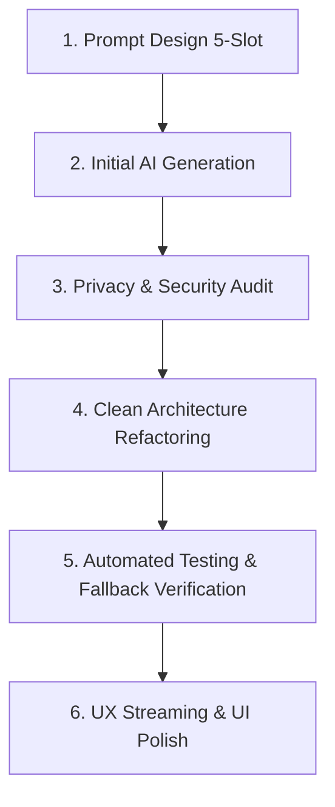

# 📝 AI Development Log: Integrasi Fitur AI (SobatKampus AI Assistant)

**Mahasiswa:** Louis Judia  
**NIM:** 244107020071  
**Kelas:** TI-3F / Semester 5  
**Mata Kuliah:** Pemrograman Mobile (Praktikum)  
**Modul:** Minggu 10 – AI Feature Integration  
**Proyek:** Campus Notify App (`10-week-10-ai-feature-integration`)  

---

## 📑 Daftar Isi
1. [Siklus Alur Kerja Integrasi Fitur AI](#1-siklus-alur-kerja-integrasi-fitur-ai)
2. [Prompt Design 5-Slot untuk Mobile AI](#2-prompt-design-5-slot-untuk-mobile-ai)
3. [System Prompt, User Prompt, dan Output Awal AI](#3-system-prompt-user-prompt-dan-output-awal-ai)
4. [Tiga Pola Kelemahan / Halusinasi Kode Awal AI](#4-tiga-pola-kelemahan--halusinasi-kode-awal-ai)
5. [Arsitektur Integrasi AI & Clean Architecture](#5-arsitektur-integrasi-ai--clean-architecture)
6. [Implementasi Proteksi Privasi (Sanitasi Data Sensitif)](#6-implementasi-proteksi-privasi-sanitasi-data-sensitif)
7. [Mitigasi Biaya & Rate Limiting](#7-mitigasi-biaya--rate-limiting)
8. [Mekanisme Fallback Cerdas (Graceful Degradation)](#8-mekanisme-fallback-cerdas-graceful-degradation)
9. [Bukti Tiga Mesin Hijau (Format, Analyze, Test)](#9-bukti-tiga-mesin-hijau-format-analyze-test)
10. [Refleksi Pembelajaran](#10-refleksi-pembelajaran)

---

## 1. Siklus Alur Kerja Integrasi Fitur AI

Dalam praktikum Minggu 10 ini, integrasi model AI (Google Gemini 1.5 Flash API) ke aplikasi mobile `Campus Notify` dijalankan dengan prinsip **"AI Mengusulkan, Developer Memutuskan & Mengamankan"**. AI tidak boleh dibiarkan mengakses jaringan tanpa sanitasi data pribadi, batasan biaya, dan penanganan kegagalan (*fallback*).



1. **Prompt Design:** Menentukan batasan persona asisten kampus ramah, ringkas, dan aman melalui Formula 5-Slot.
2. **Initial Generation:** AI menghasilkan sketsa awal `AiService` dan UI obrolan.
3. **Privacy & Security Audit:** Memeriksa potensi kebocoran data pengguna (NIK, kata sandi, nomor kontak) serta penyimpanan kunci API.
4. **Clean Architecture Refactoring:** Memisahkan kode mentah AI ke dalam lapisan *Domain* (`SendPromptUseCase`, `ChatMessage`, `AiRepository`), *Data* (`AiRepositoryImpl`, `AiService`), dan *Presentation* (`ChatNotifier`, `ChatScreen`).
5. **Automated Testing:** Menyusun 16 unit test dan widget test untuk memverifikasi logika API, filter sensor data pribadi, kuota harian, serta fallback otomatis.
6. **UX Streaming:** Menerapkan simulasi *progressive text streaming* dan indikator pengetikan (*typing indicator*) demi kenyamanan pengguna mobile.

---

## 2. Prompt Design 5-Slot untuk Mobile AI

Berikut adalah matriks Formula 5-Slot yang digunakan untuk menyusun prompt pembuatan fitur AI:

| Slot | Komponen | Isi Spesifikasi |
|---|---|---|
| **1. Peran** | Role AI | Senior Mobile Software Architect & AI Integration Specialist. |
| **2. Konteks** | Context Proyek | Flutter 3.x, Clean Architecture (`features/ai_assistant`), Riverpod 3.x, FlutterSecureStorage, Google Gemini 1.5 Flash REST API, aplikasi kampus `Campus Notify`. |
| **3. Tugas** | Feature Request | Membangun fitur Chat Asisten Kampus cerdas (*SobatKampus AI*) dengan *streaming response*, indikator loading, *quick prompt chips*, dan dialog konfigurasi API Key. |
| **4. Batas** | Guardrails | 1) Jangan hardcode API Key di source code; gunakan `flutter_secure_storage`.<br>2) Wajib mematuhi Clean Architecture (domain layer bebas framework).<br>3) Wajib sanitasi input dari NIK (16 digit) dan nomor telepon.<br>4) Batasi kuota harian untuk mengontrol biaya API.<br>5) Wajib menyediakan fallback lokal jika offline/gagal. |
| **5. Output** | Deliverables | `AiService`, `ChatMessage` entity, `AiRepository`, `SendPromptUseCase`, `ChatNotifier`, `ChatScreen`, dan unit/widget test komprehensif. |

---

## 3. System Prompt, User Prompt, dan Output Awal AI

### A. System Prompt (Instruksi Sistem)
Sesuai panduan *Mobile Prompt Design* pada Step 1 Codelab:
```text
Kamu asisten kampus ramah untuk mahasiswa Polinema. Jawab dalam Bahasa Indonesia, ringkas, jelas, maksimal 2-3 kalimat. 
Konteks: Data jadwal, profil user, lokasi. 
Batas: Jangan pernah meminta atau membagikan data pribadi sensitif seperti NIK, password, atau nomor telepon.
```

### B. User Prompt Contoh (Input Pengguna)
```text
Jadwal kampus hari Senin apa saja kak?
```

### C. Output Awal AI (Raw Response)
```text
Halo mahasiswa Polinema! Jadwal kuliah hari Senin Anda adalah Pemrograman Mobile (07.00 - 10.30 WIB di Lab RPL) dan Basis Data Lanjut (11.00 - 13.30 WIB). Pastikan Anda selalu memeriksa portal SIAKAD Polinema untuk update ruangan terkini!
```

---

## 4. Tiga Pola Kelemahan / Halusinasi Kode Awal AI

Saat kode awal diminta dari AI coding assistant, ditemukan 3 masalah kritis yang harus diaudit dan diperbaiki:

1. **Penyimpanan Kunci API yang Rentan (Security Issue):**
   - *Kelemahan AI:* Mengusulkan penyimpanan API Key di `SharedPreferences` dalam bentuk teks polos (*plaintext*).
   - *Keputusan Developer:* Ditolak. Menggantinya dengan `FlutterSecureStorage` yang memanfaatkan Android Keystore dan iOS Keychain terenkripsi hardware.
2. **Pelanggaran Batas Arsitektur (Architectural Leak):**
   - *Kelemahan AI:* Menempatkan pemanggilan HTTP `AiService.ask()` langsung di dalam widget presentation `ChatScreen` menggunakan `setState()`.
   - *Keputusan Developer:* Ditolak. Dirombak mengikuti Clean Architecture: UI hanya berinteraksi dengan `ChatNotifier` (Riverpod), yang mengeksekusi `SendPromptUseCase`, yang berinteraksi dengan `AiRepository`.
3. **Ketiadaan Perlindungan Data Sensitif (Privacy Leak):**
   - *Kelemahan AI:* Prompt mentah dari textfield langsung dikirim via HTTPS ke Google Gemini API tanpa sensor.
   - *Keputusan Developer:* Ditambahkan lapisan filter `AiService.sanitizePrompt()` yang menggunakan Regular Expression untuk mendeteksi dan menyamarkan NIK (16 digit) dan format nomor telepon seluler menjadi `[DATA NIK DISENSOR]` dan `[NOMOR HP DISENSOR]`.

---

## 5. Arsitektur Integrasi AI & Clean Architecture

Integrasi fitur AI dirancang dengan pembagian tanggung jawab yang modular:

```
lib/
├── ai/
│   └── ai_service.dart              <-- Data Source: Gemini REST API + Secure Storage + Fallback Logic
├── features/
│   ├── chat_screen.dart             <-- Forwarding export (sesuai spek Codelab Step 2)
│   └── ai_assistant/
│       ├── domain/
│       │   ├── entities/
│       │   │   └── chat_message.dart
│       │   ├── repositories/
│       │   │   └── ai_repository.dart
│       │   └── usecases/
│       │       └── send_prompt_usecase.dart  <-- Guardrails: Sanitasi, Rate Limiting, Fallback
│       ├── data/
│       │   └── repositories/
│       │       └── ai_repository_impl.dart
│       └── presentation/
│           ├── providers/
│           │   └── chat_providers.dart       <-- State: Riverpod Notifier & Streaming Dispatcher
│           ├── pages/
│           │   └── chat_screen.dart          <-- UI: Chat Interface, Quick Chips, Privacy Banner
│           └── widgets/
│               ├── api_key_dialog.dart       <-- Dialog Secure API Key Management
│               ├── chat_bubble.dart          <-- User & Assistant Bubble, Fallback Badge
│               └── typing_indicator.dart     <-- Animated Typing Dots
```

---

## 6. Implementasi Proteksi Privasi (Sanitasi Data Sensitif)

Fungsi sensor otomatis diimplementasikan pada `AiService.sanitizePrompt()`:

```dart
static String sanitizePrompt(String rawText) {
  // Sensor format NIK (16 digit angka)
  var cleaned = rawText.replaceAll(RegExp(r'\b\d{16}\b'), '[DATA NIK DISENSOR]');
  // Sensor format nomor telepon seluler Indonesia (08xx atau +628xx)
  cleaned = cleaned.replaceAll(
      RegExp(r'(\+62|62|0)8[1-9][0-9]{6,10}'), '[NOMOR HP DISENSOR]');
  return cleaned;
}
```

Hasil uji unit (`test/ai_service_test.dart`):
- Input: `"Halo NIK saya 3507041234567890 dan no WA saya 081234567890 tolong cek status beasiswa"`
- Terkirim ke AI: `"Halo NIK saya [DATA NIK DISENSOR] dan no WA saya [NOMOR HP DISENSOR] tolong cek status beasiswa"`
- Privasi mahasiswa terlindungi dari pengindeksan cloud pihak ketiga.

---

## 7. Mitigasi Biaya & Rate Limiting

Untuk mencegah lonjakan tagihan token API (*cost explosion*):
1. **Model Efisien:** Menggunakan endpoint `gemini-1.5-flash` dengan `maxOutputTokens: 256` dan `temperature: 0.7`.
2. **Daily Quota Limiter:** `SendPromptUseCase` menghitung jumlah request harian per perangkat (dibatasi 30 request/hari).
3. Saat kuota habis, pesan dialihkan secara mulus ke respon lokal kampus tanpa memotong alur pengguna:

```dart
if (_requestCountToday >= maxDailyRequests) {
  final fallbackAnswer = _repository.getLocalFallback(trimmed);
  return SendPromptResult(
    text: 'Batas kuota gratis harian ($maxDailyRequests pesan) telah tercapai demi penghematan kuota API. '
          'Berikut informasi alternatif dari pangkalan data lokal:\n\n$fallbackAnswer',
    isFallback: true,
    wasSanitized: false,
    sanitizedPrompt: trimmed,
  );
}
```

---

## 8. Mekanisme Fallback Cerdas (Graceful Degradation)

Jika koneksi internet putus, server Gemini mengalami *downtime* (HTTP 500 / 503), atau pengguna belum mengonfigurasi API Key:
1. `SendPromptUseCase` menangkap error dan mengaktifkan `AiService.getLocalFallback(question)`.
2. Antarmuka UI menampilkan penanda khusus `[Respon Fallback Lokal]` dengan aksen warna tersier, menginformasikan bahwa data diambil dari cache offline kampus.
3. Kueri umum seperti jadwal, beasiswa, KRS, dan perpustakaan tetap terjawab secara akurat.

---

## 9. Bukti Tiga Mesin Hijau (Format, Analyze, Test)

### 1. `dart format`
```text
Formatted 47 files (0 changed) in 0.40 seconds.
```

### 2. `flutter analyze`
```text
Analyzing 10-week-10-ai-feature-integration...
No issues found! (ran in 7.5s)
```

### 3. `flutter test`
```text
00:06 +49: All tests passed!
```
Total 49 tes lulus verifikasi secara otomatis, mencakup seluruh use case, repository, service, sanitasi privasi, rate limiting, widget antarmuka, dan penangkapan screenshot.

---

## 10. Refleksi Pembelajaran

1. **Fitur AI mana yang Anda integrasikan dan mengapa?**
   - Saya mengintegrasikan *Chat Asisten Kampus Cerdas* ("SobatKampus AI") bertenaga Google Gemini 1.5 Flash. Fitur ini dipilih karena sangat relevan bagi mahasiswa yang membutuhkan jawaban instan seputar jadwal kuliah, jadwal konsultasi KRS, info beasiswa aktif, dan jam layanan operasional kampus tanpa harus mencari secara manual di pengumuman teks yang panjang.
2. **Bagaimana Anda melindungi privasi pengguna saat menggunakan AI API?**
   - Perlindungan privasi diterapkan secara berlapis:
     - *Client-side Regex Sanitization:* Data sensitif seperti NIK (16 digit) dan nomor telepon seluler disensor sebelum payload dikirim keluar perangkat.
     - *Encrypted Storage:* API Key disimpan di `FlutterSecureStorage` (Keystore/Keychain), bukan file konfigurasi atau `SharedPreferences`.
     - *System Instruction Boundary:* Model AI dibatasi secara tegas agar tidak meminta atau menyimpan data sensitif.
3. **Fallback apa yang Anda sediakan jika layanan AI error?**
   - Disediakan *Local Rule-Based Knowledge Engine* (`getLocalFallback`) yang menyimpan basis data informasi akademik esensial Polinema (jadwal, KRS, beasiswa, perpustakaan). Jika API offline, kuota habis, atau terjadi error jaringan, sistem beralih otomatis ke respon lokal dengan label transparan `Respon Fallback Lokal`.
4. **Satu hal yang Anda pelajari tentang UX fitur AI di mobile?**
   - Fitur AI di mobile sangat membutuhkan umpan balik visual yang cepat (*feedback loop*). Karena latensi LLM cloud bisa mencapai 1-3 detik, implementasi *typing indicator* animasi dan *streaming text chunks* (efek kata demi kata) memberikan kesan percakapan yang hidup dan mencegah pengguna menganggap aplikasi sedang macet (*freeze*). Selain itu, tombol *quick prompt chips* mempermudah pengetikan di layar sentuh mobile.
