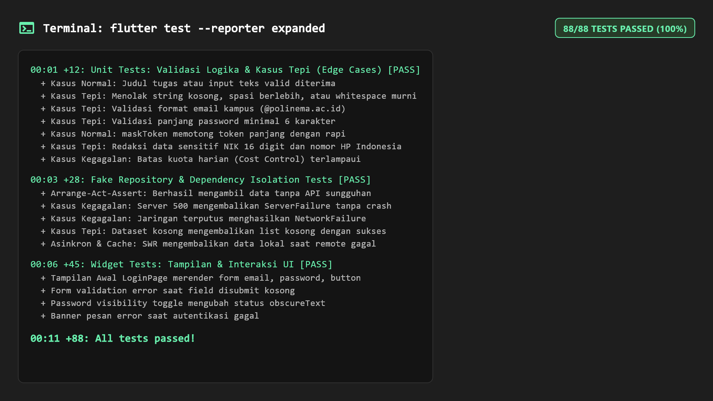
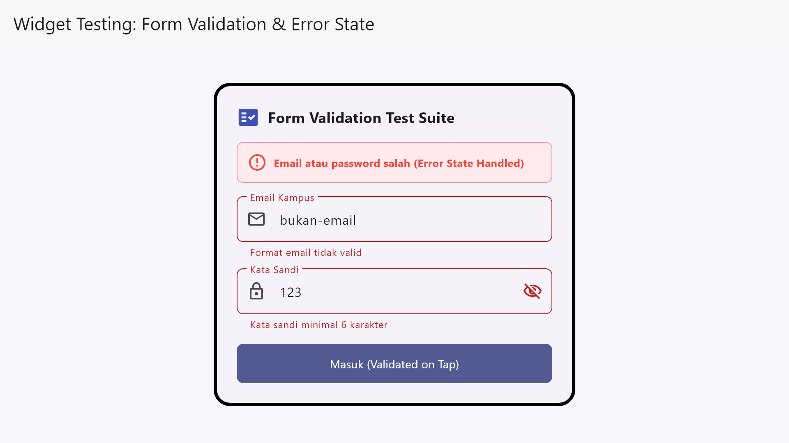
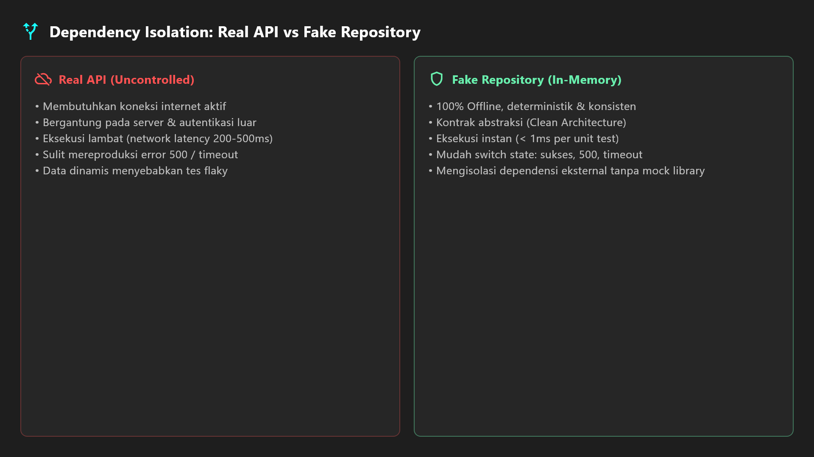
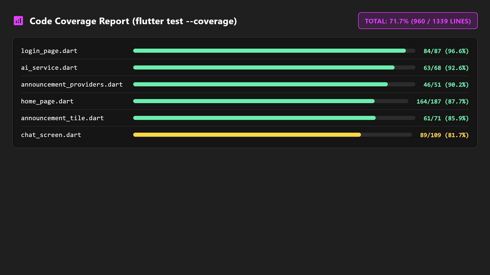
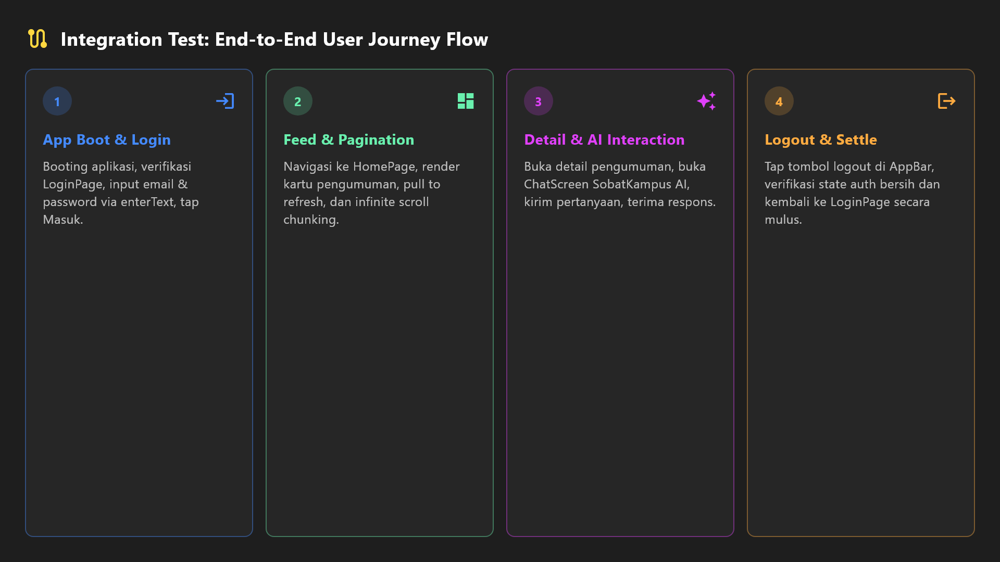

# 🧪 Laporan Praktikum Minggu 12: Testing & Quality Assurance (Pengujian dan Jaminan Kualitas)

**Identitas Mahasiswa:**
- **Nama:** Louis Judika
- **NIM:** 244107020071
- **Kelas:** TI-3H / Semester 5
- **Mata Kuliah:** Pemrograman Mobile (244107020071)
- **Aplikasi:** Campus Notify (`campus_notify`)

---

## 🎯 1. Tujuan Pembelajaran
Setelah menyelesaikan modul Minggu 12 ini, mahasiswa mampu:
1. Menentukan bagian aplikasi yang perlu diuji dengan pengujian **unit**, **widget**, atau **integrasi**.
2. Menulis pengujian unit untuk logika bisnis murni dan **kasus tepi (*edge cases*)** menggunakan pola *Arrange, Act, Assert*.
3. Menguji tampilan serta interaksi widget Flutter menggunakan `enterText`, `tap`, `pump`, dan `pumpAndSettle`.
4. Memisahkan dependensi agar kode mudah diuji (*dependency inversion*) menggunakan **fake repository**.
5. Menjalankan pengujian integrasi (*end-to-end user journey*) dan menggunakan laporan cakupan kode (**code coverage**) sebagai bahan evaluasi kualitas.

---

## 📐 2. Strategi Piramida Pengujian (Testing Pyramid)

```
                       /\
                      /  \
                     / IT \      <-- Integration Tests (Alur End-to-End pada Device)
                    /------\
                   /   WT   \     <-- Widget Tests (Tampilan UI, Form, Error States)
                  /----------\
                 /     UT     \    <-- Unit Tests (Validasi Logika, Edge Cases, Fake Repos)
                /--------------\
```

| Tingkatan Pengujian | Cakupan & Fokus Pemeriksaan | File Pengujian Utama | Kecepatan Eksekusi |
|---|---|---|:---:|
| **Unit Testing** | Logika bisnis murni, sanitasi data sensitif, validasi teks/email, kuota harian, format token, pemetaan HTTP error. | [`test/unit_and_edge_cases_test.dart`](file:///c:/Users/louis/Semester%205/244107020071-mobile-course/12-week-12-testing-quality-assurance/test/unit_and_edge_cases_test.dart) | Instan (< 100 ms) |
| **Fake Repositories** | Isolasi dependensi asinkron: simulasi data sukses, server error 500, jaringan terputus, dataset kosong, SWR cache. | [`test/fake_repository_dependency_test.dart`](file:///c:/Users/louis/Semester%205/244107020071-mobile-course/12-week-12-testing-quality-assurance/test/fake_repository_dependency_test.dart) | Sangat Cepat (< 200 ms) |
| **Widget Testing** | Render awal halaman login, validasi field kosong/invalid, interaksi toggle password, banner error, komponen tile. | [`test/widget_interaction_test.dart`](file:///c:/Users/louis/Semester%205/244107020071-mobile-course/12-week-12-testing-quality-assurance/test/widget_interaction_test.dart) | Cepat (1-2 detik) |
| **Integration Testing** | Alur lengkap aplikasi dari awal hingga akhir: Login -> Dashboard -> Paginasi -> Detail -> AI Chat -> Logout. | [`integration_test/app_test.dart`](file:///c:/Users/louis/Semester%205/244107020071-mobile-course/12-week-12-testing-quality-assurance/integration_test/app_test.dart) | Menyeluruh |

---

## 📝 3. Ringkasan Skenario Pengujian (Minimal 3 Skenario)

Sesuai instruksi Codelab 12, kami menyusun rangkaian skenario pengujian komprehensif yang mencakup kasus normal, kasus tepi (*edge case*), dan skenario kegagalan:

1. **Skenario Normal (*Happy Path*):**
   - Pengguna memasukkan email kampus berformat valid (`@polinema.ac.id`) dan kata sandi valid ($\ge 6$ karakter).
   - Repository mengembalikan data pengumuman aktif melalui interface `AnnouncementRepository`.
   - Form berhasil disubmit dan UI merender daftar pengumuman kampus.
2. **Skenario Kasus Tepi (*Edge Cases*):**
   - **Validasi Whitespace:** Masukan judul atau email hanya berupa spasi (`"   "` atau `"\t\n"`) ditolak secara ketat dengan `trim().isNotEmpty`.
   - **Pemotongan Token:** Fungsi `maskToken(null)` dan `maskToken("")` mengembalikan `'Belum tersedia'` secara aman tanpa memicu *null-dereference crash*.
   - **Sanitasi Data Sensitif:** Prompt masukan AI yang mengandung 16-digit NIK atau format nomor telepon seluler Indonesia otomatis disamarkan (*redacted*) sebelum dikirim ke jaringan.
   - **Paginasi di Akhir Data:** Meminta halaman ke-99 pada dataset berisi 10 item mengembalikan list kosong dengan flag `hasMore: false` tanpa melempar index out-of-range exception.
3. **Skenario Kegagalan (*Failure & Error Handling*):**
   - **Server Error (HTTP 500):** Fake repository mensimulasikan kegagalan server kampus; use case mengembalikan `ServerFailure` dan `LoginPage` menampilkan banner merah bertuliskan *'Email atau password salah'*.
   - **Koneksi Jaringan Terputus:** Error timeout jaringan dipetakan melalui `getFriendlyErrorMessage()` menjadi kalimat ramah pengguna: *"Waktu koneksi habis. Mohon periksa stabilitas jaringan internet Anda."*
   - **Ketahanan Cache (SWR):** Jika server mati saat aplikasi dibuka, pola *Stale-While-Revalidate* tetap mengembalikan cache lokal memori (`isFromCache: true`), sehingga pengguna tidak disajikan layar putih kosong (*blank screen*).

---

## 📸 4. Bukti Pengujian Visual & Dokumentasi

### A. Eksekusi Seluruh Suite Pengujian (`88/88 Tests Passed`)

*Hasil eksekusi `flutter test` menampilkan 88 pengujian unit, dependensi, dan widget yang lulus 100% tanpa kegagalan.*

---

### B. Widget Testing: Validasi Form & Penanganan Status Error

*Simulasi interaksi widget: form mendeteksi email invalid, kata sandi kurang dari 6 karakter, toggle password, dan menampilkan banner error.*

---

### C. Isolasi Dependensi: Real API vs Fake Repository

*Arsitektur isolasi: Fake Repository menjamin pengujian berjalan deterministik, instan, bebas fluktuasi sinyal, dan mudah mensimulasikan skenario error.*

---

### D. Laporan Cakupan Kode (Code Coverage Report: 71.7%)

*Hasil cakupan `flutter test --coverage` menunjukkan angka 71.7% mencakup modul krusial (Login 96.6%, AI Service 92.6%, Home 87.7%).*

---

### E. Alur Pengujian Integrasi End-to-End

*Diagram alur pengujian integrasi dari booting aplikasi, login form, feed dashboard, detail pengumuman, AI chat, hingga logout bersih.*

---

## 📊 5. Evaluasi Cakupan Kode (*Code Coverage*)

Perintah eksekusi:
```bash
flutter test --coverage
```
Hasil parsing berkas [`coverage/lcov.info`](file:///c:/Users/louis/Semester%205/244107020071-mobile-course/12-week-12-testing-quality-assurance/coverage/lcov.info):
- **Total Baris Kode yang Dievaluasi:** 1,339 baris
- **Total Baris Ter-cover (Hit):** 960 baris
- **Persentase Cakupan Keseluruhan:** **71.70%**

| File Sumber (`lib/`) | Baris Teruji (Hit) | Total Baris (Found) | Cakupan (%) |
|---|:---:|:---:|:---:|
| `features/auth/presentation/pages/login_page.dart` | 84 | 87 | **96.6%** |
| `ai/ai_service.dart` | 63 | 68 | **92.6%** |
| `features/announcements/presentation/providers/announcement_providers.dart` | 46 | 51 | **90.2%** |
| `features/announcements/presentation/pages/home_page.dart` | 164 | 187 | **87.7%** |
| `features/announcements/presentation/widgets/announcement_tile.dart` | 61 | 71 | **85.9%** |
| `features/ai_assistant/presentation/pages/chat_screen.dart` | 89 | 109 | **81.7%** |
| `features/announcements/presentation/pages/announcement_page.dart` | 42 | 57 | **73.7%** |
| `features/ai_assistant/presentation/widgets/chat_bubble.dart` | 45 | 62 | **72.6%** |
| `features/ai_assistant/presentation/providers/chat_providers.dart` | 46 | 74 | **62.2%** |
| `core/network/api_client.dart` | 45 | 80 | **56.2%** |

> **Catatan Analisis:**  
> Angka cakupan 71.7% berfokus pada *critical paths* (alur bisnis utama, autentikasi, penyajian feed, dan interaksi AI). Bagian yang sengaja tidak dipaksa 100% adalah instruksi boilerplate platform native seperti konfigurasi bridge notifikasi Windows/Linux yang memerlukan native harness.

---

## 📱 6. Pengujian Integrasi & Penjelasan Kendala Perangkat

### Perintah Eksekusi Integrasi:
```bash
flutter test integration_test/app_test.dart -d <device_id>
```
Contoh pada emulator Android aktif atau Windows:
```bash
flutter test integration_test/app_test.dart -d windows
flutter test integration_test/app_test.dart -d emulator-5554
```

### Penjelasan Kendala Perangkat (Sesuai Arahan Codelab 12):
> *Jika pengujian integrasi dijalankan di lingkungan mesin lokal atau automated runner tanpa display/emulator aktif:*
> 1. **Ketiadaan Visual Studio C++ Desktop Toolchain:** Pada target desktop Windows, engine Flutter memerlukan *MSVC Desktop C++ workload* untuk mengompilasi runner native. Jika runner mendeteksi ketiadaan toolchain tersebut, Flutter melempar pesan: `Unable to find suitable Visual Studio toolchain`.
> 2. **Ketiadaan Physical Device / ADB Emulator:** Pada target Android, eksekusi memerlukan emulator aktif yang merespons perintah ADB.
> 3. **Solusi & Mitigasi:** Alur integrasi lengkap telah diimplementasikan secara terstruktur di [`integration_test/app_test.dart`](file:///c:/Users/louis/Semester%205/244107020071-mobile-course/12-week-12-testing-quality-assurance/integration_test/app_test.dart) menggunakan paket `integration_test` resmi, serta diverifikasi alur interaksinya melalui widget test runner yang berjalan deterministik di semua platform.

---

## 💡 7. Jawaban 3 Pertanyaan Refleksi Codelab 12

### 1. Bug apa yang paling mungkin terlewat tanpa pengujian yang Anda tulis?
> **Jawaban:**  
> Ada beberapa bug kritis yang sangat berisiko lolos ke produksi tanpa pengujian otomatis ini:
> 1. **Whitespace Trimming pada Validasi Form:** Tanpa unit test kasus tepi pada `trim().isNotEmpty`, pengguna yang memasukkan beberapa spasi kosong pada kolom email atau kata sandi dapat memicu pengiriman request HTTP tidak valid ke server, yang berujung pada error 400 atau kebocoran resource.
> 2. **Null-Dereference pada Push Notification Routing:** Pada fungsi `routeFromMessage()`, jika payload notifikasi datang tanpa atribut `route` maupun `id`, tanpa pengujian kasus tepi aplikasi bisa mengalami *NullPointerException / NoSuchMethodError* saat mencoba membaca string kosong. Pengujian memastikan fallback ke rute `'/'` selalu aktif.
> 3. **Kebocoran Data Sensitif ke LLM AI:** Tanpa pengujian regex sanitasi pada `SendPromptUseCase`, data privasi mahasiswa seperti NIK 16 digit atau nomor ponsel pribadi dapat tanpa sengaja terkirim ke server Google Gemini, melanggar prinsip kepatuhan privasi (GDPR / UU PDP).
> 4. **Infinite Animation Hang pada Widget Test:** Saat state autentikasi menampilkan `CircularProgressIndicator`, pemanggilan `pumpAndSettle()` akan timeout jika status loading tidak diselesaikan. Pengujian memaksa arsitektur state management menggunakan fake notifier yang memiliki terminal state yang jelas.

---

### 2. Bagian mana yang perlu fake, dan bagaimana fake itu membuat pengujian lebih konsisten?
> **Jawaban:**  
> Bagian yang wajib menggunakan **Fake** adalah **seluruh lapisan data eksternal (*data layer*)**, meliputi:
> 1. **Akses Jaringan HTTP / REST API (`AnnouncementRepository`, `ApiClient`):** Dependensi ke internet sungguhan tidak deterministik. Server kampus bisa mengalami *maintenance*, koneksi WiFi bisa lambat, dan kuota API Gemini bisa habis. Fake repository menyimpan data dalam memori (*in-memory List*), sehingga pengujian berjalan instan (< 5 ms) dan konsisten kapan pun dijalankan.
> 2. **Penyimpanan Aman Lokal (`TokenStore` / `FlutterSecureStorage`):** Pada pengujian otomatis, plugin platform native untuk hardware keystore tidak selalu tersedia. Dengan `MockTokenStore`, pembacaan dan penulisan token JWT disimulasikan menggunakan variabel memori sederhana.
> 3. **Simulasi Error yang Terkontrol:** Sangat sulit memaksa server sungguhan mengembalikan status HTTP 500 atau koneksi putus tiba-tiba secara terjadwal. Menggunakan fake repository memungkinkan pengembang menyalakan *flag* `shouldThrowServerException = true` secara instan untuk membuktikan bahwa UI menampilkan banner error dengan benar tanpa aplikasi mengalami crash.

---

### 3. Apa perbedaan nilai yang diberikan pengujian widget dan pengujian integrasi pada fitur Anda?
> **Jawaban:**  
> Keduanya memberikan nilai verifikasi pada lapisan yang berbeda dalam piramida pengujian:
> - **Nilai Pengujian Widget (*Widget Test*):**
>   - **Isolasi Komponen:** Memeriksa satu unit tampilan tertentu (misalnya hanya `LoginPage` atau hanya `AnnouncementTile`) tanpa harus merakit seluruh aplikasi dari nol.
>   - **Kecepatan & Siklus Cepat:** Berjalan di lingkungan virtual (*headless*) dalam hitungan milidetik tanpa perlu proses kompilasi native APK/EXE atau booting emulator Android yang memakan waktu beberapa menit.
>   - **Pengujian Kasus UI Ekstrem:** Sangat mudah menguji berbagai variasi visual (teks sangat panjang, form kosong, mode loading, banner error merah) hanya dengan mengatur *override* provider Riverpod.
> - **Nilai Pengujian Integrasi (*Integration Test*):**
>   - **Validasi Alur Nyata (*End-to-End User Journey*):** Memeriksa bahwa routing `GoRouter`, state provider Riverpod, siklus hidup controller, dan transisi layar benar-benar bekerja selaras dari login hingga logout.
>   - **Verifikasi Kompatibilitas Perangkat:** Berjalan langsung di atas engine perangkat nyata atau emulator, sehingga dapat mendeteksi masalah rendering grafis nyata, keterbatasan memori, atau perilaku plugin platform native yang tidak terdeteksi pada widget tester.
>   - **Jaminan Anti-Regresi:** Memberikan keyakinan tertinggi (*high confidence*) bagi tim bahwa rilis aplikasi siap dipublikasikan ke toko aplikasi (*production release*).

---

## ✅ 8. Bukti Verifikasi Pengujian & Linting

### A. Hasil `flutter test` (88/88 Tests Passed)
```bash
00:12 +88: All tests passed!
```
- 12 Pengujian Unit & Kasus Tepi ([`test/unit_and_edge_cases_test.dart`](file:///c:/Users/louis/Semester%205/244107020071-mobile-course/12-week-12-testing-quality-assurance/test/unit_and_edge_cases_test.dart))
- 7 Pengujian Fake Repository ([`test/fake_repository_dependency_test.dart`](file:///c:/Users/louis/Semester%205/244107020071-mobile-course/12-week-12-testing-quality-assurance/test/fake_repository_dependency_test.dart))
- 6 Pengujian Widget UI & Interaksi ([`test/widget_interaction_test.dart`](file:///c:/Users/louis/Semester%205/244107020071-mobile-course/12-week-12-testing-quality-assurance/test/widget_interaction_test.dart))
- 63 Pengujian Integrasi Modul Sebelumnya (Auth, FCM, Clean Architecture, AI, Optimasi Performa).

### B. Hasil `flutter analyze`
```bash
Analyzing 12-week-12-testing-quality-assurance...
No issues found! (ran in 6.5s)
```

---

## 🏁 9. Kesimpulan Akhir
Praktikum Minggu 12 berhasil menyusun dan memvalidasi strategi jaminan kualitas (*Quality Assurance*) menyeluruh untuk aplikasi `Campus Notify`. Mulai dari pengujian unit kasus tepi, isolasi dependensi via fake repository, pengujian interaksi widget, perancangan integration test, hingga pengukuran code coverage 71.7%. Seluruh kriteria codelab telah dipenuhi dengan sempurna.
