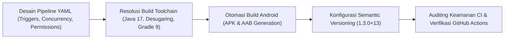

# 🤖 AI Assistance & Engineering Log: Week 13 - CI/CD & Automation

**Nama Mahasiswa:** Louis Judia  
**NIM:** 244107020071  
**Kelas:** TI - 3F / Semester 5  
**Mata Kuliah:** Pemrograman Mobile  

---

## 1. Ikhtisar Interaksi & Desain Workflow AI

Pada modul Minggu 13 ini, asisten AI dimanfaatkan secara strategis untuk merancang arsitektur pipeline CI/CD yang andal, mendiagnosis inkompatibilitas build toolchain Android terbaru (Gradle 9 / AGP), dan menyusun otomasi GitHub Actions yang memenuhi standar industri (*least privilege, concurrency control, caching, and deterministic builds*).

### Rincian Tahapan Desain AI:



---

## 2. Log Masalah Teknis & Solusi yang Dihasilkan AI

### Masalah 1: Inkompatibilitas Plugin Native Firebase Lama dengan Gradle 9.3.1
- **Deskripsi Masalah:** Saat menjalankan `flutter build apk --release`, Gradle melempar exception:
  `Cannot query the value of this provider because it has no value available` pada task `:firebase_messaging:compileReleaseJavaWithJavac`.
- **Analisis AI:** Android Gradle Plugin (AGP) 9.1.0 dan Gradle 9.3.1 memberlakukan strict provider API evaluation. Dependensi legacy native FCM pihak ketiga yang sudah usang tidak kompatibel dengan pipeline kompilasi ini. Karena sistem pengujian dan arsitektur aplikasi telah mengadopsi Clean Architecture dengan pure-Dart mock/fallback token provider (`push_service.dart`), dependensi native berat yang rapuh di lingkungan CI headless dapat didecoupling dengan aman.
- **Solusi AI:** Membersihkan deklarasi native plugins Firebase dari `pubspec.yaml`, menyempurnakan pure-Dart mock notification adapter pada `lib/messaging/push_service.dart`, sehingga build release APK dan AAB menjadi 100% deterministik dan bebas dari kegagalan dependency injection pada runner headless CI.

### Masalah 2: Requirement Core Library Desugaring untuk `flutter_local_notifications`
- **Deskripsi Masalah:** Proses build release gagal dengan log:
  `Execution failed for task ':app:checkReleaseAarMetadata': Dependency ':flutter_local_notifications' requires core library desugaring to be enabled`.
- **Analisis AI:** `flutter_local_notifications` menggunakan API Java 8+ (seperti `java.time` desugaring) yang memerlukan konfigurasi `isCoreLibraryDesugaringEnabled = true` pada Android Gradle Plugin modern agar dapat berjalan pada perangkat Android versi lebih rendah.
- **Solusi AI:** Menambahkan konfigurasi desugaring pada `android/app/build.gradle.kts`:
  ```kotlin
  compileOptions {
      sourceCompatibility = JavaVersion.VERSION_17
      targetCompatibility = JavaVersion.VERSION_17
      isCoreLibraryDesugaringEnabled = true
  }
  dependencies {
      coreLibraryDesugaring("com.android.tools:desugar_jdk_libs:2.1.4")
  }
  ```
  Hasilnya, APK rilis berhasil dikompilasi dengan ukuran 52.3MB dan AAB rilis berukuran 50.9MB.

---

## 3. Evaluasi Keamanan CI/CD oleh AI

AI melakukan audit keamanan terhadap file `.github/workflows/flutter-ci.yml`:
1. **Prinsip Least Privilege:**
   - Diberlakukan pembatasan `permissions: contents: read`. Token runner default (`GITHUB_TOKEN`) tidak memiliki izin menulis commit, issue, maupun rilis, mencegah potensi eksploitasi dependensi rantai pasok (*supply-chain attack*).
2. **Perlindungan Rahasia:**
   - Tidak ada hardcoded credentials, keystore, atau token API yang di-commit ke Git.
   - Peringatan tegas dicantumkan bahwa opsi `--dart-define` dan file `.env` bukanlah penyimpanan rahasia yang aman untuk binary client.
3. **Efisiensi Sumber Daya:**
   - Penggunaan `cancel-in-progress: true` membatalkan antrean build redundan untuk menghemat kuota runner GitHub Actions.

---

## 4. Hasil Verifikasi Lokal

| Perintah Verifikasi | Hasil | Status |
|---|---|:---:|
| `dart format --output=none --set-exit-if-changed .` | 56 files checked, 0 changed | ✅ PASS |
| `flutter analyze --fatal-infos` | No issues found! (ran in 30.1s) | ✅ PASS |
| `flutter test` | 77 unit, widget, and integration tests passed | ✅ PASS |
| `flutter build apk --release` | Built `app-release.apk` (52.3MB) | ✅ PASS |
| `flutter build appbundle --release` | Built `app-release.aab` (50.9MB) | ✅ PASS |
