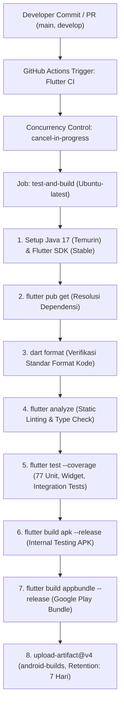

# 🚀 Dokumentasi Pipeline CI/CD Flutter (GitHub Actions)

**Nama Mahasiswa:** Louis Judia  
**NIM:** 244107020071  
**Kelas:** TI - 3F / Semester 5  
**Mata Kuliah:** Pemrograman Mobile  
**Modul:** Minggu 13 - CI/CD & Otomatisasi  

---

## 1. Ikhtisar Pipeline & Konsep CI/CD

Continuous Integration (CI) dan Continuous Delivery/Deployment (CD) adalah pilar penting dalam rekayasa perangkat lunak modern. Pada proyek Flutter ini, pipeline CI/CD diimplementasikan menggunakan **GitHub Actions** untuk memastikan:
1. Setiap kode yang diajukan (commit atau Pull Request) melalui pemeriksaan statis dan verifikasi otomatis secara konsisten tanpa tergantung lingkungan lokal developer (*works on my machine syndrome*).
2. Artefak rilis Android dalam bentuk **APK (Android Package)** dan **AAB (Android App Bundle)** diproduksi secara otomatis dan dapat diunduh untuk peninjauan (QA), uji coba tim (staging), maupun persiapan rilis ke Google Play Store.



---

## 2. Struktur Workflow GitHub Actions (`.github/workflows/flutter-ci.yml`)

File workflow didefinisikan secara deklaratif di root repositori dengan konfigurasi spesifik untuk modul Minggu 13:

### A. Triggers (Pemicu)
```yaml
on:
  push:
    branches: [main, develop]
  pull_request:
    branches: [main, develop]
  workflow_dispatch:
```
- **`push` & `pull_request`:** Menguji perubahan kode baik pada branch pengembangan (`develop`) maupun branch produksi (`main`). Menjamin tidak ada kode rusak yang ter-merge ke branch utama.
- **`workflow_dispatch`:** Memungkinkan developer atau tech lead memicu pipeline secara manual kapan saja melalui UI GitHub Actions tab.

### B. Permissions & Concurrency
```yaml
permissions:
  contents: read

concurrency:
  group: ${{ github.workflow }}-${{ github.ref }}
  cancel-in-progress: true
```
- **Least Privilege Principle (`contents: read`):** Job CI hanya membutuhkan akses baca ke kode repositori. Hak akses tulis (`write`) dinonaktifkan untuk mencegah risiko eksploitasi dependensi atau modifikasi repositori yang tidak diinginkan.
- **Concurrency Control (`cancel-in-progress: true`):** Jika developer melakukan *rapid push* (beberapa commit berurutan dalam waktu singkat), runner otomatis membatalkan build sebelumnya yang sedang berjalan pada branch yang sama, menghemat kuota runner hours GitHub Actions.

### C. Urutan Langkah (Job Steps)
| Langkah | Perintah / Action | Tujuan |
|---|---|---|
| **1. Checkout Repository** | `actions/checkout@v4` | Mengambil source code commit yang sedang diuji ke workspace runner. |
| **2. Set up Java 17** | `actions/setup-java@v4` (`temurin`, `17`) | Menyiapkan Java Development Kit untuk Gradle dan Android SDK build tools. |
| **3. Set up Flutter SDK** | `subosito/flutter-action@v2` (`channel: stable`) | Mengunduh dan mengonfigurasi Flutter SDK channel stable terbaru dengan fitur caching. |
| **4. Resolve Dependencies** | `flutter pub get` | Mengunduh seluruh paket dependensi sesuai `pubspec.lock`. |
| **5. Code Formatting** | `dart format --output=none --set-exit-if-changed .` | Memeriksa kepatuhan terhadap standar format resmi Dart. Gagal jika ada baris yang belum diformat. |
| **6. Static Analysis** | `flutter analyze --no-fatal-infos` | Analisis statis linter terhadap type safety, unused imports, dan dead code. |
| **7. Automated Testing** | `flutter test --coverage` | Menjalankan seluruh suite pengujian otomatis (77 skenario unit, widget, dan integrasi) dan menghasilkan laporan coverage LCOV. |
| **8. Build Release APK** | `flutter build apk --release` | Mengompilasi binary APK standalone untuk pengujian fisik di perangkat Android. |
| **9. Build Release AAB** | `flutter build appbundle --release` | Mengompilasi Android App Bundle teroptimasi untuk distribusi Google Play Store. |
| **10. Upload Artifacts** | `actions/upload-artifact@v4` | Mengunggah APK dan AAB ke server GitHub Actions dengan retensi 7 hari. |

---

## 3. Strategi Semantic Versioning (SemVer)

Aplikasi dikonfigurasi mengikuti standar [Semantic Versioning 2.0.0](https://semver.org/):

```yaml
# pubspec.yaml
version: 1.3.0+13
```

### Format: `MAJOR.MINOR.PATCH+BUILD_NUMBER`
- **`MAJOR` (1):** Perubahan arsitektur besar yang berpotensi *breaking changes* (misal perombakan total core clean architecture dan API layer).
- **`MINOR` (3):** Penambahan fitur baru yang *backward-compatible* (misalnya penambahan modul Minggu 13: CI/CD automation & release packaging).
- **`PATCH` (0):** Perbaikan bug (*bug fixes*) dan refactoring performa tanpa mengubah fungsionalitas publik.
- **`BUILD_NUMBER` (+13):** Nomor inkremental unik untuk setiap kompilasi rilis.

### Mapping Platform Native:
- **Android:**
  - `versionName` $\rightarrow$ `1.3.0` (ditampilkan ke pengguna di Google Play Store dan setelan aplikasi).
  - `versionCode` $\rightarrow$ `13` (integer unik internal Android yang wajib dinaikkan pada setiap upload rilis Google Play Console).
- **iOS:**
  - `CFBundleShortVersionString` $\rightarrow$ `1.3.0`
  - `CFBundleVersion` $\rightarrow$ `13`
- **Git Tagging Strategy:**
  - Setiap commit yang lolos pipeline CI dan disetujui untuk rilis diberi tag Git semantik: `v1.3.0`.
  - Tag ini menjadi jangkar pelacak riwayat antara commit Git, log runner GitHub Actions, dan artefak binary (`app-release.apk` & `app-release.aab`).

---

## 4. Keamanan, Rahasia (Secrets), dan Batasan Lingkungan

### A. Mengapa `--dart-define` dan `.env` Bukan Secret di Sisi Client?
Variabel yang diinjeksikan saat build Flutter via `--dart-define` atau file `.env` akan **dikompilasi langsung ke dalam bytecode/binary aplikasi**. 
- Siapapun yang mengunduh APK/AAB dapat melakukan reverse engineering (misal menggunakan `apktool`, `jadx`, atau perintah `strings` di binary `libapp.so`) untuk mengekstrak string tersebut dalam hitungan menit.
- **Aturan Praktis:** Hanya simpan *public configuration* (seperti Base URL API staging/prod, timeouts, Google Client ID publik) pada `--dart-define`.
- **Kredensial Sensitif:** API secret key yang memiliki hak admin, private key payment gateway, atau database master credentials **TIDAK BOLEH** diletakkan di aplikasi klien. Gunakan backend proxy (BFF - Backend for Frontend) untuk mengelola token privat tersebut.

### B. Manajemen Android Signing Keystore & GitHub Secrets
1. **Pemisahan Pipeline CI dan Release CD:**
   - Job CI reguler (yang dipicu oleh pull request dari kontributor atau branch tim) tidak boleh memiliki akses ke Android Production Keystore.
   - Keystore produksi (`upload-keystore.jks`) harus di-encode ke Base64 dan disimpan di **GitHub Actions Secrets** (`SIGNING_KEYSTORE_BASE64`, `KEYSTORE_PASSWORD`, `KEY_ALIAS`, `KEY_PASSWORD`).
   - Workflow rilis terisolasi (misal dipicu hanya oleh pembuatan Git tag `v*` atau manual approval di *GitHub Environments*) yang mendekode keystore secara dinamis pada saat build dan langsung menghapusnya setelah proses signing selesai.

---

## 5. Refleksi & Evaluasi Modul Codelab

### Pertanyaan 1: Masalah apa yang ditemukan otomatis sebelum perubahan di-merge?
> **Jawaban:**
> 1. **Formatting Violations:** Pelanggaran gaya kode (spasi, indentasi, urutan imports) yang tidak sesuai standar `dart format` langsung terdeteksi dan menggagalkan pipeline.
> 2. **Analisis Statis & Linter Errors:** Typo pada deklarasi variabel, pemanggilan fungsi dengan parameter usang, impor file yang tidak ditemukan, atau variabel yang tidak digunakan (*unused imports/variables*) terdeteksi oleh `flutter analyze`.
> 3. **Regression Bugs:** Perubahan pada satu modul (misalnya perbaikan model atau data source) yang secara tidak sengaja merusak fungsionalitas use case lain langsung tertangkap oleh suite 77 automated tests (`flutter test`).
> 4. **Gradle & Android Build Incompatibilities:** Masalah kompilasi native (seperti dependensi Kotlin/Java desugaring atau ketidaksesuaian Android Gradle Plugin) langsung terdeteksi saat `flutter build apk` dijalankan, mencegah rilis aplikasi yang *crash* saat di-*launch*.

### Pertanyaan 2: Informasi apa yang Anda butuhkan untuk menyelidiki build yang gagal?
> **Jawaban:**
> 1. **Step Name & Exit Code:** Mengetahui pada tahap apa pipeline gagal (apakah saat `dart format`, `flutter analyze`, `flutter test`, atau `flutter build`).
> 2. **Error Log & Stack Trace:** Baris pesan kesalahan spesifik, misalnya file dan baris kode tempat terjadinya *assertion failure* pada unit test, atau error log Gradle saat proses link manifest.
> 3. **Git Commit Hash & Branch Ref:** Commit SHA yang memicu build untuk mereproduksi issue di lingkungan lokal pada commit yang sama persis.
> 4. **Environment Metadata:** Versi Flutter SDK (`flutter --version`), Java runtime version, dan cache status runner untuk memastikan tidak terjadi drift dependensi lingkungan.

### Pertanyaan 3: Bagian mana yang masih perlu persetujuan atau pemeriksaan manual sebelum rilis?
> **Jawaban:**
> 1. **Keystore Production Signing:** Otorisasi penggunaan private key signing rilis resmi (harus melewati manual gate atau approval tim security/lead engineer).
> 2. **Physical Device Smoke & Usability Testing:** Pengujian aspek fisik yang tidak dapat sepenuhnya disimulasikan oleh headless runner CI, seperti performa rendering 120Hz pada layar riil, respon biometrik sidik jari, handling kamera perangkat, dan penerimaan push notification Firebase secara real-time.
> 3. **Release Notes & Legal Compliance:** Tinjauan manual terhadap changelog rilis, kepatuhan kebijakan Google Play Store (privacy policy disclosure, app permissions), dan kesiapan operasional server backend sebelum persentase rollout dinaikkan ke 100%.
